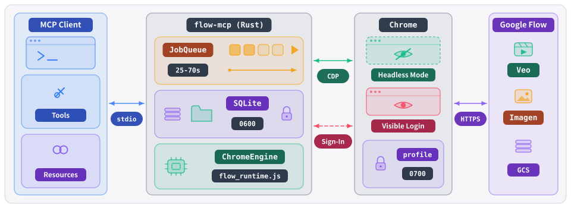
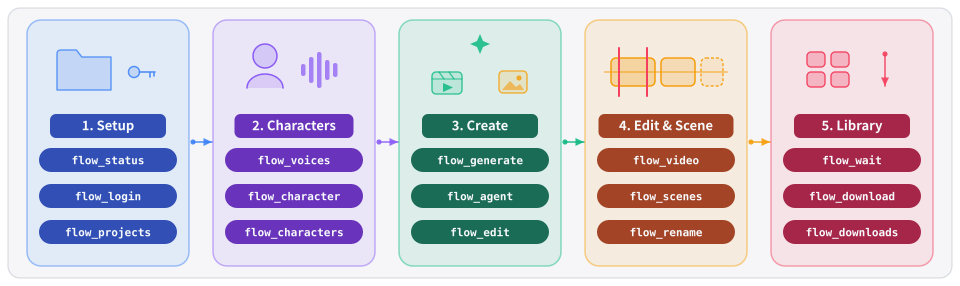

**English** | [简体中文](docs/zh-CN/README.md) | [日本語](docs/ja/README.md)

# flow-mcp

`flow-mcp` is a single-binary Rust stdio Model Context Protocol (MCP) server for Google Flow (`Veo` and `Imagen`). It serves 22 MCP tools and download resources through `rmcp` over standard input and output.

`ChromeEngine` manages a persistent Chrome or Chromium profile in `<home>/chrome-profile` (`0700` permissions on Unix). During background work, it connects over local Chrome DevTools Protocol (CDP) to headless Chrome (`--headless=new`). During Google Sign-In in `flow_login`, it opens a visible Chrome window without CDP flags. This lets Google authentication and Device Bound Session Credentials (DBSC) finish normally.

A single-worker `JobQueue` runs generation, edit, video extend, and character jobs one at a time with random pauses. It downloads media files with natural names into `<home>/downloads` and indexes them in SQLite.



## Quick install

Install Node.js `18` or newer and Google Chrome or Chromium on your host computer:

```sh
npx -y @flow-mcp/cli --help
```

Or install the CLI globally:

```sh
npm install --global @flow-mcp/cli
flow-mcp --help
```

With `@flow-mcp/cli`, `npm` installs the matching optional package (`@flow-mcp/darwin-arm64`, `@flow-mcp/darwin-x64`, `@flow-mcp/linux-arm64`, `@flow-mcp/linux-x64`, `@flow-mcp/win32-arm64`, or `@flow-mcp/win32-x64`). Linux packages use `glibc`. On `musl` systems (for example Alpine Linux), build from source.

> [!IMPORTANT]
> Do not pass `--omit=optional` or `--no-optional`. Those flags skip the native binary package. You also need Google Chrome or Chromium on the host computer at runtime.

You can also download standalone binaries from [GitHub Releases](https://github.com/ByteLandTechnology/flow-mcp/releases):

| Platform | x86_64 | ARM64 |
| :--- | :--- | :--- |
| macOS | `flow-mcp-macos-x86_64` | `flow-mcp-macos-arm64` |
| Linux | `flow-mcp-linux-x86_64` | `flow-mcp-linux-arm64` |
| Windows | `flow-mcp-windows-x86_64.exe` | `flow-mcp-windows-arm64.exe` |

To build from source, install Rust `1.88` (or newer) and Node.js. `esbuild` bundles `ts/index.ts` at compile time, so the compiled binary does not need Node.js at runtime:

```sh
git clone https://github.com/ByteLandTechnology/flow-mcp.git
cd flow-mcp
npm ci
cargo build --release
```

Add `@flow-mcp/cli` to your MCP stdio client configuration (`mcpServers`):

```json
{
  "mcpServers": {
    "flow-mcp": {
      "command": "npx",
      "args": ["-y", "@flow-mcp/cli", "--home", "/path/to/.flow-mcp"],
      "env": {
        "FLOW_MCP_PAUSE_MIN_S": "25",
        "FLOW_MCP_PAUSE_MAX_S": "70"
      }
    }
  }
}
```

## Documentation map

Read the guide sections for each task:

| Guide | Focus | Key topics |
| :--- | :--- | :--- |
| [Quickstart](docs/en/quickstart.md) | Tutorial | Install `flow-mcp`, configure a client, sign in, and generate a video |
| [Architecture](docs/en/architecture.md) | Explanation | Dual-mode `ChromeEngine`, DBSC handoff, `JobQueue`, 45s wait limit, and `<home>` security |
| [Workflows](docs/en/workflows.md) | Procedures | Video and image jobs, characters, edits, scenes, `read_chunk`, and cookie sync |
| [Tools Reference](docs/en/tools-reference.md) | Reference | CLI options, environment variables, MCP resources, and all 22 tools |

## Tool overview and media workflows



| Domain | Tools | Purpose |
| :--- | :--- | :--- |
| Session & Projects | `flow_status`, `flow_login`, `flow_new_project`, `flow_projects` | Check session state, sign in with Chrome, and manage projects |
| Characters & Voices | `flow_voices`, `flow_character`, `flow_character_edit`, `flow_characters` | List Flow voices, create or update characters, and store SQLite profiles |
| Generation & Batch | `flow_generate`, `flow_agent_images`, `flow_edit` | Queue Veo video or Imagen image jobs, run Agent batches, or edit assets |
| Video & Scenes | `flow_video`, `flow_scenes` | Trim videos without source changes, extend clips, and manage scene timelines |
| Queue Control | `flow_wait`, `flow_cancel`, `flow_retry` | Wait for jobs (`PATIENCE_MS = 45s`), stop jobs, or run failed jobs again |
| Library & Media | `flow_assets`, `flow_rename`, `flow_collections`, `flow_download`, `flow_downloads`, `flow_trash` | Filter tiles, rename items, group collections, download files, read chunks, or trash items |

Read [Tools Reference](docs/en/tools-reference.md) for every parameter and response field.
