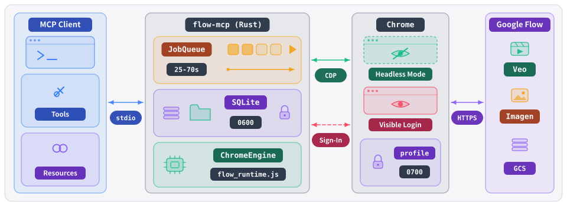
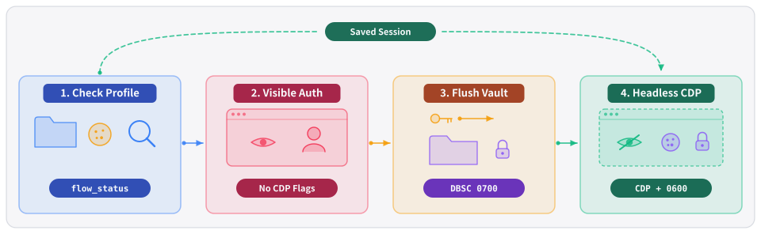
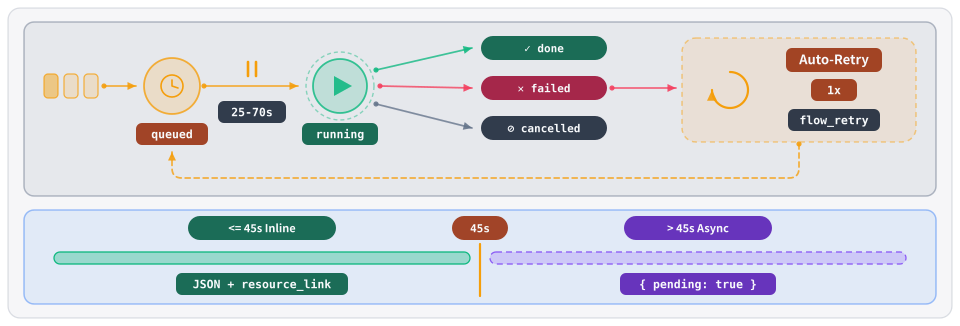
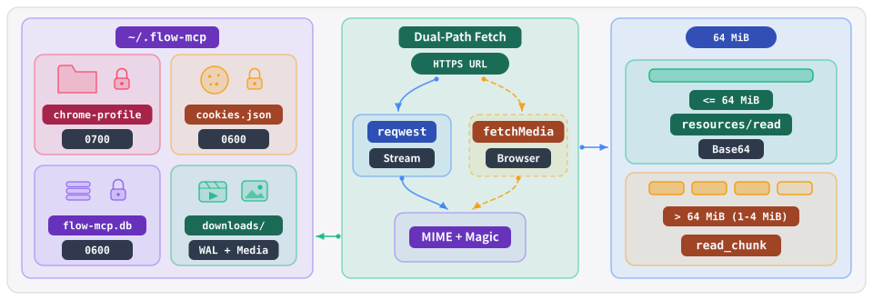

# Architecture

`flow-mcp` places MCP stdio transport, serial queue scheduling, local storage, and browser control in one static Rust binary with an embedded TypeScript runtime.

## 1. Runtime layers and TypeScript bundle

| Component | Module(s) | Role |
| :--- | :--- | :--- |
| MCP Adapter | `src/mcp.rs` | Serves MCP tools (`tools/call`) and MCP resources (`resources/list`, `resources/templates/list`, `resources/read`) through `rmcp` stdio |
| Service Coordinator | `src/service.rs` | Routes tool requests between SQLite, `JobQueue`, and `ChromeEngine` |
| Serial Worker | `src/queue.rs` | Runs browser mutation jobs one at a time on a FIFO queue with random pauses |
| Browser Engine | `src/engine.rs`, `src/chrome.rs`, `src/cdp.rs` | Manages `ManagedChrome` (CDP), `LoginChrome` (visible non-CDP), WebSocket CDP RPC, and `Network` events |
| Browser Runtime | `ts/*.ts` (`build.rs`) | `esbuild` bundles 26 flat TypeScript modules into `OUT_DIR/flow_runtime.js`; `src/engine.rs` embeds it once and sets `window.__flowMcp` |
| Local Persistence | `src/db.rs`, `src/cookies.rs`, `src/download.rs`, `src/platform.rs`, `src/instance.rs` | Manages `flow-mcp.db` (`0600`), `cookies.json` (`0600`), `<home>/chrome-profile` (`0700`), and `<home>/downloads` |

Inside the Google Flow page, `ts/` reads live Angular state from the `lService` store (`read_store_snapshot.ts` and `discover_store.ts`) instead of static mocks. When mutations run, Rust monitors both store updates and CDP HTTP responses for `aisandbox-pa.googleapis.com` and `batchexecute` (`is_flow_mutation_rpc_ok`).

All browser sessions pin the interface language to English (`hl=en` and `en-US`). This keeps Angular controls, menu labels, and voice lists consistent across all host locales.

## 2. Dual-mode Chrome and DBSC session handoff

Google authentication checks Device Bound Session Credentials (DBSC) and automation signals during interactive sign-in. Visible Chrome with remote debugging flags often fails sign-in or DBSC binding. `ChromeEngine` avoids this problem with two separate browser modes:

1. **`LoginChrome` (interactive mode only)**:
   - Launches standard visible Chrome on `<home>/chrome-profile` (`0700` Unix permissions) **without** CDP flags and opens Google Sign-In (`?hl=en`).
   - When `wait=true` (default, `timeout_secs=180`), `flow_login` checks the profile directory for Flow URLs and Google cookies without CDP probes.
   - After sign-in finishes, `ChromeEngine::promote_login_chrome` stops `LoginChrome`. Chromium then flushes cookies and DBSC keys to `<home>/chrome-profile`.
2. **`ManagedChrome` (default background mode)**:
   - Starts Chrome with a visible window on `<home>/chrome-profile` (or headless Chrome with `--headless`) with a local WebSocket CDP connection (`--cdp-port`, `FLOW_MCP_CDP_PORT`, or port `0`).
   - Evaluates the embedded `flow_runtime.js` IIFE bundle on page load. It writes normalized cookies atomically to `<home>/cookies.json` (`0600` permissions on Unix).
3. **Cookie normalization and native profile priority**:
   - Normalization keeps only `google.com`, `labs.google`, `googleusercontent.com`, and `gstatic.com` domains. It also keeps `__Host-` prefixes and `hostOnly` flags.
   - If `<home>/chrome-profile` holds valid native Google cookies, `flow-mcp` keeps them unchanged. It does not overwrite them with older data from `<home>/cookies.json`.
4. **Single-instance lock and orphaned Chrome**:
   - Before Chrome starts, `flow-mcp` takes an exclusive lock on `<home>/flow-mcp.lock` (`0600` on Unix) and keeps it until the process stops. The operating system releases the lock when the process stops, also after a crash.
   - If another process holds the lock, the Chrome start, `login`, `status`, `logout`, and `flow_login` with `logout` fail with an error. `doctor` shows a warning.
   - While `flow-mcp` holds the lock, each Chrome process on `<home>/chrome-profile` that it did not start is orphaned. `flow-mcp` asks these processes to stop (`SIGINT` on Unix, `taskkill` on Windows) and stops them by force after 3 seconds.

## 3. `JobQueue` serialization and 45-second inline wait

Running parallel edits on one Google Flow Angular tab causes UI race conditions, lost uploads, and wrong RPC attribution. `JobQueue` prevents these errors with strict serial execution:

- **Single background worker**: Only one generation, edit, video extend, or character job runs at a time. Finished jobs stay in a FIFO history list with at most `200` items.
- **Random pauses between jobs**: Before each next job, the worker pauses for a random time in the `--pause` or `FLOW_MCP_PAUSE` range (`25,70` seconds by default).
- **Agent turns**: The Agent uses a separate project page. An open response holds the execution lock that media jobs use.
- **Inline wait window (`PATIENCE_MS = 45_000`)**: Many MCP clients cancel tool calls after `60` seconds. `flow_wait` and `flow_download` wait up to `45` seconds per call, then return `{"pending": true, ...}` so you can poll again with `flow_wait`, `flow_status`, or `flow_downloads`.

## 4. Storage boundary and dual-path downloads

`flow-mcp` stores all state in one configurable root directory (`--home <PATH>`, `FLOW_MCP_HOME`, or `~/.flow-mcp`) with private Unix permissions:

| Path under `<home>` | Unix mode | Role |
| :--- | :--- | :--- |
| `chrome-profile/` | `0700` | Persistent Chrome profile, DBSC keys, and live session cookies |
| `cookies.json` | `0600` | Normalized Google and Flow cookie array that `flow-mcp` writes atomically |
| `flow-mcp.lock` | `0600` | Single-instance lock that a process holds while it can start Chrome |
| `flow-mcp.db` | `0600` | SQLite database in `WAL` mode for `downloads`, `character_looks`, and `characters` |
| `downloads/` | Private dir | Fixed folder for all downloaded media; `flow-mcp` rejects external output paths |

### Media download pipeline (`flow_download` and job downloads)

1. **URL resolution**: `flow-mcp` reads cached URLs from the project snapshot and active TanStack `queryCache`. On a cache miss, verified builds call the native Flow media service (`RJ`), while unverified builds and audio assets use single-pass sparse `as29s` wire decoding.
2. **Primary HTTP stream (`reqwest`)**: `reqwest` streams bytes to a temporary file. For signed storage and Flow CDN URLs (`storage.googleapis.com` and its subdomains, `flow-content.google`, `labs-flow.dev`, `video-downloads.googleusercontent.com`, and V2 or V4 query-signed URLs), it omits `Cookie` and `Referer` headers; for unsigned Google URLs, it sends `Referer: https://flow.google.com/` and Chrome cookies.
3. **Browser `fetchMedia` fallback**: If the HTTP stream fails, `ChromeEngine` runs `fetchMedia` inside the Flow page (`credentials: "omit"` on signed CDNs) and decodes the Base64 result.
4. **Validation and natural naming**: `flow-mcp` rejects zero-byte files and checks `Content-Type` plus magic bytes. It selects the file name from `Content-Disposition`, the URL path, or `<asset_id>.<ext>`, resolves duplicate names, and updates SQLite (`downloads`).
5. **MCP resource serving**: `flow-mcp` registers each download as `flow://downloads/{id}` and `flow://downloads/asset/{asset_id}`. `resources/list` returns `100` items per page. `resources/read` serves files up to `64 MiB` as Base64, while `flow_downloads` (`action="read_chunk"`) reads larger files in slices.
