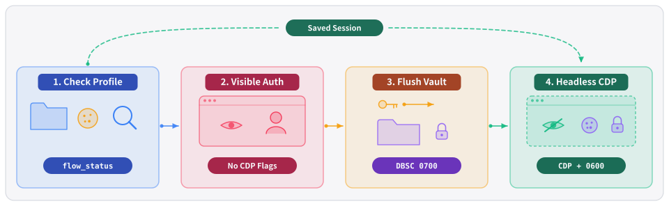

# Quickstart

Follow this guide to install `flow-mcp`, connect an MCP client, sign in to Google Flow, and generate a video.

## Prerequisites

Prepare these items on the host computer:

- **Google Chrome or Chromium**: You need Chrome or Chromium at runtime for sign-in and Flow automation. Set `--chrome <PATH>` or `FLOW_MCP_CHROME` if auto-detection misses your browser binary.
- **Google account with Flow access**: Prepare a Google account that can open [Google Flow](https://flow.google.com/?hl=en).
- **Node.js `18` or newer**: Install Node.js to run `@flow-mcp/cli`, or download a standalone binary from [GitHub Releases](https://github.com/ByteLandTechnology/flow-mcp/releases).

## 1. Install `flow-mcp`

Choose one of these three methods:

- **Method A — Run with `npx` or `npm` (recommended)**:

```sh
npx -y @flow-mcp/cli --help
```

Or install globally to add `flow-mcp` to `PATH`:

```sh
npm install --global @flow-mcp/cli
flow-mcp --version
```

`npm` installs the matching optional package (`@flow-mcp/darwin-arm64`, `@flow-mcp/darwin-x64`, `@flow-mcp/linux-arm64`, `@flow-mcp/linux-x64`, `@flow-mcp/win32-arm64`, or `@flow-mcp/win32-x64`). Do not pass `--omit=optional` or `--no-optional`.

- **Method B — Download a prebuilt binary**: Download the file for your OS and CPU from [GitHub Releases](https://github.com/ByteLandTechnology/flow-mcp/releases). On Unix, run `chmod +x flow-mcp`, then run `--version`.

- **Method C — Build from source**: Install Rust `1.88+` (2024 edition) and Node.js. `npm ci` installs `esbuild` and TypeScript to bundle `ts/index.ts` during compilation.

```sh
git clone https://github.com/ByteLandTechnology/flow-mcp.git
cd flow-mcp
npm ci
cargo build --release
./target/release/flow-mcp --help
```

## 2. Configure your MCP client

Add `flow-mcp` to your MCP stdio client configuration (`mcpServers`):

```json
{
  "mcpServers": {
    "flow-mcp": {
      "command": "npx",
      "args": [
        "-y", "@flow-mcp/cli", "serve",
        "--home", "/path/to/.flow-mcp"
      ],
      "env": {
        "FLOW_MCP_PAUSE": "25,70"
      }
    }
  }
}
```

If you use a standalone binary, set `"command"` to the binary path (for example `/usr/local/bin/flow-mcp`). Pass `["serve", "--home", "/path/to/.flow-mcp"]` in `"args"`.

## 3. Sign in for the first time

`flow-mcp` runs headless CDP Chrome by default. When you need to sign in to Google, it opens a standard visible Chrome window without CDP flags.



Run these steps in order from your MCP client:

1. Check session state with `flow_status`:

```json
{
  "probe": false
}
```

If `signed_in` is `true`, skip step 2.

2. Start sign-in with `flow_login`:

```json
{
  "action": "login",
  "wait": true,
  "timeout_secs": 180
}
```

Complete Google Sign-In in the visible Chrome window. After you sign in, `flow-mcp` closes the visible window and flushes `<home>/chrome-profile`. It then starts headless CDP Chrome on that profile and saves `<home>/cookies.json` (`0600` permissions on Unix).

You can also sign in from a terminal with `flow-mcp login --home /path/to/.flow-mcp`. Stop your MCP client first, because two `flow-mcp` processes cannot use one Chrome profile at the same time. Run `flow-mcp status` to check the result.

## 4. Create a project and generate a video

1. Create and open a project with `flow_new_project`:

```json
{
  "title": "Demo Reel"
}
```

2. Queue a video job with `flow_generate`:

```json
{
  "prompt": "Slow dolly shot over a sunlit bamboo forest in morning mist",
  "mode": "video",
  "model": "veo-3.1-fast",
  "aspect": "16:9",
  "count": 2,
  "download": true
}
```

`flow_generate` returns a `JobView` object with `id` and `status: "queued"`.

3. Wait for the job to finish with `flow_wait`:

```json
{
  "id": "<job_id>",
  "timeout": 600
}
```

`flow_wait` waits up to `45` seconds per call. If the job still runs at `45` seconds, it returns `{"pending": true, "jobs": [...]}` to prevent a client timeout. Call `flow_wait` again until `status` is `"done"`.

4. List downloaded files with `flow_downloads`:

```json
{
  "action": "list",
  "limit": 10
}
```

`flow-mcp` stores all downloads in `<home>/downloads` and assigns a resource URI (for example `flow://downloads/1`). MCP clients that support `resources/read` can read files up to `64 MiB`. For larger files, call `flow_downloads` with `action="read_chunk"`.

## Troubleshooting

- **Check the installation**: Run `flow-mcp doctor` to check the Chrome binary, `<home>` and file permissions, the profile lock, and the sign-in status.
- **Missing native executable package**: Reinstall `@flow-mcp/cli` without `--omit=optional` or `--no-optional`.
- **Chrome binary not found**: Set `--chrome <PATH>` or `FLOW_MCP_CHROME` to your Chrome or Chromium executable path.
- **Expired or rejected Google sign-in**: Call `flow_login` with `{"action": "login", "force": true}` to open a clean Chrome window. Or call `{"action": "logout"}` to delete `<home>/chrome-profile` and `<home>/cookies.json`.
- **Call returns `{"pending": true}` after `45` seconds**: The background job keeps running. Call `flow_wait` again, or check `flow_status` and `flow_downloads`.

## Next steps

- Read [Architecture](architecture.md) to learn about `ChromeEngine`, `JobQueue`, and storage boundaries.
- Read [Workflows](workflows.md) for video, image, character, edit, and scene procedures.
- Read [Tools Reference](tools-reference.md) for all parameters and response fields.
