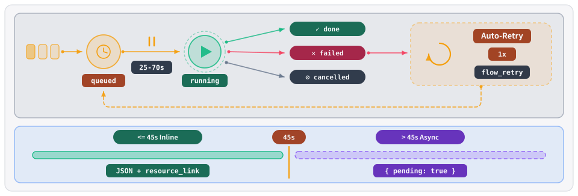

# Tools Reference

This page documents CLI flags, environment variables, MCP resources, response objects, and all MCP tools in `flow-mcp` (`v0.2.0`).

## CLI options

```text
flow-mcp [OPTIONS]
```

| Option | Effect | Priority and default |
| :--- | :--- | :--- |
| `--home <PATH>` | Set the data root directory | Overrides `FLOW_MCP_HOME`; defaults to `~/.flow-mcp` |
| `--chrome <PATH>` | Set the Chrome or Chromium binary path | Overrides `FLOW_MCP_CHROME` and OS discovery |
| `-h`, `--help` | Print CLI help and exit | — |
| `-V`, `--version` | Print `flow-mcp 0.2.0` and exit | — |

## Environment variables

| Variable | Effect | Default and bounds |
| :--- | :--- | :--- |
| `FLOW_MCP_HOME` | Root directory for `flow-mcp.db`, `downloads/`, `cookies.json`, and `chrome-profile/` | `~/.flow-mcp` |
| `FLOW_MCP_CHROME` | Override path to Chrome or Chromium executable | OS paths and Playwright cache |
| `FLOW_MCP_CHROME_CDP_PORT` | Pin the local Chrome DevTools Protocol TCP port | Ephemeral port (`0`); positive `u16` |
| `FLOW_MCP_PAUSE_MIN_S` | Minimum random delay in seconds between queued jobs | `25` (`0.0..=86400.0`) |
| `FLOW_MCP_PAUSE_MAX_S` | Maximum random delay in seconds between queued jobs | `70` (`0.0..=86400.0`, at least min) |

## MCP resources specification

- **`resources/list`**: Returns existing files in `<home>/downloads` (`100` entries per page, `cursor` integer offset string) with `flow://downloads/<id>` URIs, MIME types, and byte sizes.
- **`resources/templates/list`**: Exposes `flow://downloads/{id}` (SQLite row ID) and `flow://downloads/asset/{asset_id}` (latest download for a Flow asset ID).
- **`resources/read`**: Returns Base64 `blob` payloads and MIME type for files up to `64 MiB`. For larger files, it returns an invalid-params error pointing to `flow_downloads` `action="read_chunk"`.
- **`resource_link` blocks**: When the client negotiates MCP protocol `2025-06-18` or newer (or omits the version), `flow_download` adds a `resource_link` block alongside the JSON payload.

## Shared response objects



- **`JobView`** (`flow_generate`, `flow_agent_images`, `flow_edit`, `flow_video` extend, `flow_character`, `flow_character_edit`, `flow_wait`, `flow_cancel`, `flow_retry`):
  - Fields: `id` (`8`-char string), `status` (`"queued"`, `"running"`, `"done"`, `"failed"`, `"cancelled"`), `prompt`, `name?`, `mode?`, `model?`, `created_at?`, `started_at?`, `finished_at?` (Unix ms), `progress?`, `files?`, `created?`, `resources?`, `error?`, `retried_from?`.
- **`DownloadRecord`** (`flow_download`, `flow_downloads`):
  - Fields: `id`, `asset_id`, `project_id?`, `project_title?`, `name`, `kind`, `prompt?`, `source_url?`, `file_path`, `file_name`, `mime_type?`, `size_bytes`, `asset_created_at?`, `downloaded_at` (Unix ms), `exists` (bool), `resource_uri` (`flow://downloads/<id>`).

---

## 1. Session & project tools

### `flow_status`

Check Google Flow authentication state, active project, `JobQueue`, SQLite index count, and Chrome readiness.

| Parameter | Type | Required | Description |
| :--- | :--- | :--- | :--- |
| `probe` | `boolean` | No | Set `true` to check the active Chrome page without navigation. Default `false`. |

Returns `{ flow: FlowStatus, queue: [...], downloads_count, home, db_path, downloads_dir, cookies_saved, profile_dir, ... }`. Does not open or create projects.

### `flow_login`

Sign in through Chrome or manage Flow cookies.

| Parameter | Type | Required | Description |
| :--- | :--- | :--- | :--- |
| `action` | `string` | No | `"login"` (`"start"`, default), `"sync_cookies"` (`"import_cookies"`), `"save_cookies"`, `"status"`, or `"logout"` (`"reset_session"`, `"clear_cookies"`). |
| `wait` | `boolean` | No | For `"login"`, poll Chrome until sign-in finishes. Default `true`. |
| `timeout_secs` | `integer` | No | Maximum wait seconds when `wait=true`. Default `180`. |
| `force` | `boolean` | No | Delete saved cookies and profile before `LoginChrome` starts. Default `false`. |
| `cookies` | `object[]` | No | Cookie array for `"sync_cookies"`. If you omit this field, `flow-mcp` loads `<home>/cookies.json`. |

### `flow_new_project`

Open the Flow home page, create a project, and set a title if needed. Returns `created`, `clicked`, `project_id`, `title`, and `url`.

| Parameter | Type | Required | Description |
| :--- | :--- | :--- | :--- |
| `title` | `string` | No | Project title that `flow-mcp` applies after creation. |

### `flow_projects`

List, create, open, rename, or delete Google Flow projects.

| Parameter | Type | Required | Description |
| :--- | :--- | :--- | :--- |
| `action` | `string` | No | `"list"` (default), `"create"`, `"open"`, `"rename"`, or `"delete"`. |
| `id` | `string` | No | Target project ID for `"open"`, `"rename"`, or `"delete"`. |
| `title` | `string` | No | New title for `"create"` or `"rename"`, or case-insensitive title match for `"open"` or `"delete"`. |

---

## 2. Characters & voice tools

### `flow_voices`

Open the character voice picker in Google Flow and list available voices.

| Parameter | Type | Required | Description |
| :--- | :--- | :--- | :--- |
| `character` | `string` | No | Optional existing character ID or name to open the voice picker. |

### `flow_character`

Queue a character creation job on `JobQueue` and save metadata (`id`, `project_id`, `name`, `bio`, `voice`, `ref_asset_ids`) in SQLite. Returns a `JobView`.

| Parameter | Type | Required | Description |
| :--- | :--- | :--- | :--- |
| `name` | `string` | Yes | Character display name. |
| `description` | `string` | No | Visual look description. If you omit `bio`, `flow-mcp` uses this text as `bio`. |
| `bio` | `string` | No | Introduction or personality notes. |
| `voice` | `string` | No | Voice name (for example `"Kore"`, `"Charon"`, or a name from `flow_voices`). |
| `asset_ids` | `string[]` | No | Existing project image asset IDs to attach as character looks. |
| `refs` | `string[]` | No | Local reference image file paths to upload as looks. |
| `prompt` | `string` | No | Prompt to generate a character look inside the editor. |

### `flow_character_edit`

Queue an update job for `/character/<id>` and update SQLite character metadata. Returns a `JobView`.

| Parameter | Type | Required | Description |
| :--- | :--- | :--- | :--- |
| `name` | `string` | Yes | Existing character ID or name substring to match. |
| `new_name` | `string` | No | Updated display name. |
| `bio` | `string` | No | Updated biography or notes. |
| `voice` | `string` | No | Updated voice name. |
| `asset_ids` | `string[]` | No | Project image asset IDs to attach as looks. |
| `refs` | `string[]` | No | Local reference image paths to upload. |
| `prompt` | `string` | No | Edit or look generation prompt inside the character editor. |

### `flow_characters`

List characters in the active project. Merges live Flow tiles with stored SQLite `bio`, `voice`, and `ref_asset_ids` fields. Takes no parameters.

---

## 3. Generation & editing tools

### `flow_generate`

Queue a Veo video or Imagen image generation job on `JobQueue`. Returns a `JobView`.

| Parameter | Type | Required | Description |
| :--- | :--- | :--- | :--- |
| `prompt` | `string` | Yes | Text prompt that `flow-mcp` sends to Google Flow. |
| `mode` | `string` | No | `"video"` (default) or `"image"`. |
| `model` | `string` | No | Model override. Defaults to `"veo-3.1-fast"` (`video`) or `"nano-banana-2"` (`image`). |
| `aspect` | `string` | No | Aspect ratio: `"16:9"` (default), `"9:16"`, or `"1:1"`. |
| `count` | `integer` | No | Output batch count in `1..=4`. Default `2`. |
| `frames` | `string[]` | No | Local reference or keyframe image paths to upload before submission. |
| `asset_ids` | `string[]` | No | Existing project image asset IDs to attach as ingredients or frames. |
| `characters` | `string[]` | No | Character IDs or names to attach to the prompt controls. |
| `video_type` | `string` | No | Video generation mode: `"frames"` or `"ingredients"`. |
| `duration` | `string` | No | Video duration setting (for example `"5s"` or `"8s"`). |
| `resolution` | `string` | No | Video resolution setting (for example `"720p"`, `"1080p"`, or `"4K"`). |
| `name` | `string` | No | Optional scene or asset label for the job. |
| `download` | `boolean` | No | Download generated assets into `<home>/downloads` on completion. Default `true`. |
| `character_role` | `string` | No | Key in SQLite `character_looks` that appends `", character {role}: {look}"` to `prompt`. |
| `character_look` | `string` | No | Saves look text under `character_role` in SQLite and appends it to `prompt`. |

### `flow_agent_images`

Queue a Flow Agent Mode batch image job (`mode="image"`, `480`-second wait window, `1x` retry on `"agent finished without creating"`). Returns a `JobView`.

| Parameter | Type | Required | Description |
| :--- | :--- | :--- | :--- |
| `prompt` | `string` | Yes | Batch image prompt for Flow Agent Mode. |
| `model` | `string` | No | Model override. Default `"nano-banana-2"`. |
| `aspect` | `string` | No | Aspect ratio (`"16:9"` default, `"9:16"`, or `"1:1"`). |
| `count` | `integer` | No | Output count in `1..=4`. Default `2`. |

### `flow_edit`

Queue an edit job for an existing image or video asset through the UI edit trigger or `/edit/<id>`. Returns a `JobView`.

| Parameter | Type | Required | Description |
| :--- | :--- | :--- | :--- |
| `match` | `string` | Yes | Case-insensitive asset ID, name, or prompt substring matching the source asset. |
| `prompt` | `string` | Yes | Edit instruction for the matched asset. |

---

## 4. Video & scene tools

### `flow_video`

Apply non-destructive trims or queue a video extension job.

| Parameter | Type | Required | Description |
| :--- | :--- | :--- | :--- |
| `action` | `string` | Yes | `"trim"` (immediate RPC update) or `"extend"` (queues a `JobQueue` job returning `JobView`). |
| `match` | `string` | Yes | Video asset ID, exact name, or case-insensitive substring. |
| `start_seconds` | `number` | No | Trim start timestamp in seconds for `"trim"` (`null` clears start bound). |
| `end_seconds` | `number` | No | Trim end timestamp in seconds for `"trim"` (`null` clears end bound). |
| `prompt` | `string` | No | Continuation prompt for `"extend"`. |
| `scene_id` | `string` | No | Optional existing scene ID to extend inside. |

### `flow_scenes`

List, create, populate, rename, or trash Flow scene timelines.

| Parameter | Type | Required | Description |
| :--- | :--- | :--- | :--- |
| `action` | `string` | No | `"list"` (default), `"create"`, `"add_clips"`, `"rename"`, or `"trash"`. |
| `id` | `string` | No | Target scene ID (`"add_clips"` and `"rename"` need this field; optional for `"trash"`). |
| `name` | `string` | No | Scene name for `"create"`, `"rename"`, or optional match for `"trash"`. |
| `asset_ids` | `string[]` | No | Source clip asset IDs (optional for `"create"`, non-empty for `"add_clips"`). |
| `position` | `integer` | No | Insertion clip index for `"add_clips"`. |

---

## 5. Queue control tools

### `flow_wait`

Wait for queued or running jobs to finish. Blocks up to `45` seconds per call (`PATIENCE_MS`) and returns `{"pending": true, "jobs": [...]}` if still active.

| Parameter | Type | Required | Description |
| :--- | :--- | :--- | :--- |
| `ids` | `string[]` | No | Specific 8-character job IDs to wait on. If you omit `ids` and `id`, `flow-mcp` waits on all jobs. |
| `id` | `string` | No | Single job ID when you omit `ids`. |
| `timeout` | `integer` | No | Maximum total wait target in seconds. Default `600`; internal limit `24` hours. |

### `flow_cancel`

Remove a `"queued"` job at once or stop a `"running"` job. Fails on unknown IDs.

| Parameter | Type | Required | Description |
| :--- | :--- | :--- | :--- |
| `id` | `string` | Yes | Eight-character job ID from `JobQueue`. |

### `flow_retry`

Queue a failed or cancelled job again with `retried_from` set to `id`. Fails on unknown IDs.

| Parameter | Type | Required | Description |
| :--- | :--- | :--- | :--- |
| `id` | `string` | Yes | Original eight-character job ID. |

---

## 6. Library, collections & download tools

### `flow_assets`

List project tiles read from the Flow Angular `lService` snapshot.

| Parameter | Type | Required | Description |
| :--- | :--- | :--- | :--- |
| `query` | `string` | No | Case-insensitive substring matching asset ID, name, or prompt. |
| `kind` | `string` | No | Filter by `"image"`, `"video"`, `"scene"`, `"character"`, or `"all"` (default). |
| `collection` | `string` | No | Filter by collection ID, name substring, `"all"`, `"none"`, or `"uncollected"`. |
| `limit` | `integer` | No | Maximum items to return (`>= 1`). |

### `flow_rename`

Rename assets, characters, scenes, or collections in batches and confirm through RPC or snapshot.

| Parameter | Type | Required | Description |
| :--- | :--- | :--- | :--- |
| `items` | `object[]` | Yes | Non-empty array of `{"id": "...", "name": "..."}` entries. |

### `flow_collections`

List, create, rename, populate, remove items from, or delete project collections.

| Parameter | Type | Required | Description |
| :--- | :--- | :--- | :--- |
| `action` | `string` | Yes | `"list"`, `"create"`, `"rename"`, `"add"`, `"remove"`, or `"delete"`. |
| `name` | `string` | No | Collection name for `"create"` or `"delete"`. |
| `from` | `string` | No | Existing collection ID or name for `"rename"` or `"delete"`. |
| `to` | `string` | No | New collection name for `"rename"`. |
| `collection` | `string` | No | Target collection ID or name for `"add"` or `"delete"` (`"add"` creates missing collections). |
| `ids` | `string[]` | No | Exact asset or character IDs to move into (`"add"`) or out of (`"remove"`) a collection. |

### `flow_download`

Download a matching project image or video to `<home>/downloads` and index it in `flow-mcp.db`. Waits up to `45` seconds (`pending: true` on timeout) and returns `{"file", "resource_uri", "record"}`. If the client supports MCP `2025-06-18` or newer, it also returns a `resource_link`.

| Parameter | Type | Required | Description |
| :--- | :--- | :--- | :--- |
| `match` | `string` | Yes | Exact asset ID, exact name, or case-insensitive substring matching a project asset. |

### `flow_downloads`

Query, check, stream Base64 slices from, prune, delete, or clear indexed downloads inside `<home>/downloads` and `flow-mcp.db`.

| Parameter | Type | Required | Description |
| :--- | :--- | :--- | :--- |
| `action` | `string` | No | `"list"` (default), `"get"`, `"read_chunk"`, `"delete"`, `"prune"`, or `"clear"`. |
| `id` | `integer` | No | SQLite download row ID (`>= 1`) for `"get"`, `"read_chunk"`, or `"delete"`. |
| `asset_id` | `string` | No | Flow asset ID for `"get"`, `"read_chunk"`, or `"delete"`. |
| `query` | `string` | No | Case-insensitive substring matching ID, name, prompt, file name, or path (`"list"`). |
| `kind` | `string` | No | Filter for `"list"`: `"image"`, `"video"`, `"scene"`, `"character"`, or `"all"` (default). |
| `project_id` | `string` | No | Filter by project ID for `"list"`. |
| `existing_only` | `boolean` | No | Return only rows whose file exists on disk for `"list"`. Default `false`. |
| `limit` | `integer` | No | Page limit for `"list"` (`1..=500`, default `50`). |
| `offset` | `integer` | No | Starting byte offset for `"read_chunk"`. Default `0`. |
| `length` | `integer` | No | Slice byte length for `"read_chunk"` (`1..=4194304`, default `1048576` / `1 MiB`). |
| `older_than_days` | `integer` | No | Age filter in days when `action="clear"`. |

### `flow_trash`

Move a matching asset, character, scene, or collection to trash in Google Flow.

| Parameter | Type | Required | Description |
| :--- | :--- | :--- | :--- |
| `match` | `string` | Yes | Case-insensitive asset or collection ID, name, or prompt substring. |
