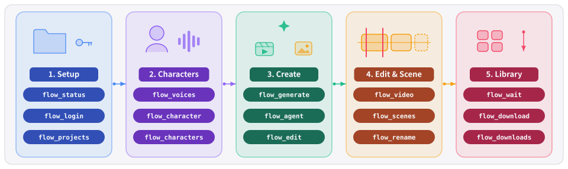
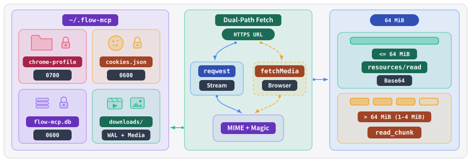

# Workflows

Follow these procedures to run video, image, character, edit, scene, library, and headless cookie tasks with `flow-mcp`.



## 1. Veo video generation (text, keyframes, and ingredients)

Queue a text-to-video job with `flow_generate`:

```json
{
  "prompt": "Low tracking shot of a red tram gliding across wet cobblestones at dusk",
  "mode": "video",
  "model": "veo-3.1-fast",
  "aspect": "16:9",
  "duration": "8s",
  "resolution": "1080p",
  "count": 2,
  "download": true
}
```

Use keyframes (`frames`) or project ingredients (`asset_ids`) with `video_type` (`"frames"` or `"ingredients"`):

```json
{
  "prompt": "Slow push-in as neon reflections ripple across the wet street",
  "mode": "video",
  "video_type": "frames",
  "frames": ["/abs/path/start-frame.png"],
  "asset_ids": ["existing_asset_id"],
  "aspect": "16:9",
  "count": 1
}
```

Wait for the job to finish:

```json
{
  "id": "<job_id>",
  "timeout": 600
}
```

Each `flow_wait` call blocks for at most `45` seconds and returns `{"pending": true, ...}` while work continues. Call `flow_wait` again until every target job reaches `"done"`.

## 2. Imagen and Agent Mode batch images

For standard image generation (`mode="image"` defaults to `nano-banana-2`):

```json
{
  "prompt": "Architectural cutaway of a serene timber library in soft morning light",
  "mode": "image",
  "model": "nano-banana-2",
  "aspect": "1:1",
  "count": 4
}
```

For Flow Agent Mode batch images, call `flow_agent_images`. It uses a `480`-second wait window and adds one retry if an error contains `"agent finished without creating"`:

```json
{
  "prompt": "Create four consistent storyboard frames of a paper lantern festival by a canal",
  "model": "nano-banana-2",
  "aspect": "16:9",
  "count": 4
}
```

## 3. Character consistency across shots

`flow-mcp` gives you two ways to keep characters consistent across shots:

1. **Flow Character Entities (`flow_voices`, `flow_character`, `flow_character_edit`, `flow_characters`)**:
   - Call `flow_voices` to list available voices (for example `"Kore"` or `"Charon"`).
   - Set `voice_sample` and `voice_performance` with a base `voice` to save a custom voice, and call `flow_voice_preview` to download its preview audio.
   - Call `flow_character` with a name, description, optional bio, voice, local `refs` paths, or `asset_ids`:

```json
{
  "name": "Captain Lin",
  "description": "Weather-worn navigator in a dark navy coat with a brass compass",
  "bio": "Calm veteran orbital tug pilot",
  "voice": "Charon",
  "refs": ["/abs/path/lin-portrait.png"]
}
```

   - Attach saved characters in later `flow_generate` calls with `"characters": ["Captain Lin"]`.
   - Call `flow_character_edit` to update a character, or call `flow_characters` to list merged Flow and SQLite records.

2. **Lightweight prompt looks (`character_role` and `character_look`)**:
   - Pass `"character_role": "courier"` and `"character_look": "yellow rain parka, scuffed boots"` once in `flow_generate`.
   - `flow-mcp` saves that pair in SQLite (`character_looks`). When you pass `"character_role": "courier"` in later `flow_generate` calls, `flow-mcp` appends `", character courier: yellow rain parka, scuffed boots"`.

## 4. Asset editing, trim, video extend, and scenes

- **Edit an existing image or video (`flow_edit`)**: Match an asset by ID, name, or prompt substring and queue an edit job:

```json
{
  "match": "lantern festival",
  "prompt": "Replace dusk sky with deep starlight and warm reflections on the water"
}
```

- **Trim a video without modifying the source (`flow_video` with `action="trim"`)**: Apply `start_seconds` and `end_seconds` at once without queuing a job. Pass `null` to clear a bound:

```json
{
  "action": "trim",
  "match": "red tram",
  "start_seconds": 1.2,
  "end_seconds": 6.5
}
```

- **Extend a video (`flow_video` with `action="extend"`)**: Queue a video extend job (inside an optional `scene_id`) and receive a `JobView`:

```json
{
  "action": "extend",
  "match": "red tram",
  "prompt": "The tram turns past a clocktower into a busy square"
}
```

- **Assemble timelines (`flow_scenes`)**: List scenes, create a scene with optional `asset_ids`, insert clips with `add_clips` at `position`, rename scenes, or trash scenes:

```json
{
  "action": "add_clips",
  "id": "<scene_id>",
  "asset_ids": ["clip_asset_1", "clip_asset_2"],
  "position": 0
}
```

## 5. Project library, collections, and large-file downloads



- **Filter and organize tiles**:
  - Search with `flow_assets` (`query`, `kind`, `collection`: collection ID, name substring, `"all"`, `"none"`, or `"uncollected"`, plus `limit`).
  - Rename items in batches with `flow_rename`: `{"items": [{"id": "asset_1", "name": "Shot 01 - Tram"}]}`.
  - Use `flow_collections` to list, create, or rename collections and move assets between them. The tool blocks collection deletion on the current Flow build.
- **Download and read files over MCP**:
  - Download a project file on demand with `flow_download` (`{"match": "Shot 01"}`).
  - Manage records in `<home>/flow-mcp.db` with `flow_downloads` (`"list"`, `"get"`, `"delete"`, `"prune"`, or `"clear"` with `older_than_days`).
  - MCP `resources/read` rejects files larger than `64 MiB`. Read them in Base64 slices (`1` byte to `4 MiB`, default `1 MiB`) with `flow_downloads` (`action="read_chunk"`):

```json
{
  "action": "read_chunk",
  "id": 1,
  "offset": 0,
  "length": 1048576
}
```

## 6. Headless server cookie sync and recovery

When you run `flow-mcp` on a Linux server without a display, start it with `--headless` (or `FLOW_MCP_HEADLESS=1`):

1. Sign in once on a computer with Chrome using `flow_login` (`action="login"`).
2. Copy `<home>/cookies.json` (`0600`) to the server, or import cookies directly in headless mode:

```json
{
  "action": "sync_cookies",
  "cookies": [
    {
      "name": "__Secure-1PSID",
      "value": "...",
      "domain": ".google.com",
      "path": "/"
    }
  ]
}
```

3. Omit `"cookies"` with `action="sync_cookies"` to reload the server's `<home>/cookies.json` into headless Chrome.
4. Call `action="save_cookies"` to save Chrome cookies to `cookies.json`, or call `action="logout"` to delete `<home>/chrome-profile` and `cookies.json`.
