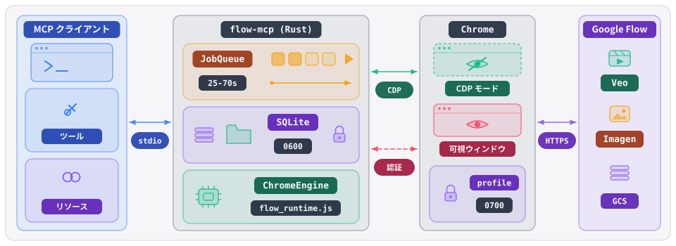
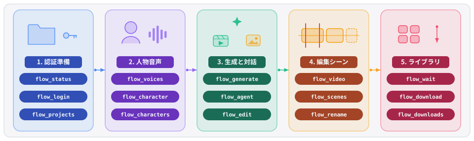

[English](../../README.md) | [简体中文](../zh-CN/README.md) | **日本語**

# flow-mcp

`flow-mcp` は、Google Flow（`Veo` および `Imagen`）向けの単一バイナリ Rust 製 stdio Model Context Protocol（MCP）サーバーです。`rmcp` を使用し、標準入出力を通じて 22 個の MCP ツールとダウンロードリソースを提供します。

`ChromeEngine` は `<home>/chrome-profile`（Unix 権限 `0700`）で永続的な Chrome または Chromium プロファイルを管理します。バックグラウンド処理中はローカルの Chrome DevTools Protocol（CDP）でヘッドレス Chrome（`--headless=new`）に接続します。`flow_login` で Google ログインを行うときは、CDP フラグなしの標準的な可視 Chrome ウィンドウを開きます。これにより Google 認証と Device Bound Session Credentials（DBSC）が正常に完了します。

単一ワーカーの `JobQueue` は、生成・編集・動画延長・キャラクタージョブをランダムな休止を挟んで 1 件ずつ順番に実行します。メディアファイルを自然なファイル名のまま `<home>/downloads` へダウンロードし、SQLite にインデックスを登録します。



## クイックインストール

ホストマシンに Node.js `18` 以上および Google Chrome または Chromium をインストールします：

```sh
npx -y @flow-mcp/cli --help
```

または CLI をグローバルにインストールします：

```sh
npm install --global @flow-mcp/cli
flow-mcp --help
```

`@flow-mcp/cli` を導入すると、`npm` は対応するオプショナルパッケージ（`@flow-mcp/darwin-arm64`、`@flow-mcp/darwin-x64`、`@flow-mcp/linux-arm64`、`@flow-mcp/linux-x64`、`@flow-mcp/win32-arm64`、または `@flow-mcp/win32-x64`）をインストールします。Linux パッケージは `glibc` を使用します。Alpine Linux などの `musl` システムでは、ソースからビルドしてください。

> [!IMPORTANT]
> `--omit=optional` および `--no-optional` は指定しないでください。これらのフラグはネイティブバイナリパッケージをスキップします。実行時にはホストマシンに Google Chrome または Chromium も必要です。

[GitHub Releases](https://github.com/ByteLandTechnology/flow-mcp/releases) から単体バイナリをダウンロードすることもできます：

| プラットフォーム | x86_64 | ARM64 |
| :--- | :--- | :--- |
| macOS | `flow-mcp-macos-x86_64` | `flow-mcp-macos-arm64` |
| Linux | `flow-mcp-linux-x86_64` | `flow-mcp-linux-arm64` |
| Windows | `flow-mcp-windows-x86_64.exe` | `flow-mcp-windows-arm64.exe` |

ソースからビルドするには、Rust `1.88`（以上）と Node.js をインストールします。コンパイル時に `esbuild` が `ts/index.ts` をバンドルするため、コンパイル後のバイナリは実行時に Node.js を必要としません：

```sh
git clone https://github.com/ByteLandTechnology/flow-mcp.git
cd flow-mcp
npm ci
cargo build --release
```

MCP stdio クライアント設定（`mcpServers`）へ `@flow-mcp/cli` を追加します：

```json
{
  "mcpServers": {
    "flow-mcp": {
      "command": "npx",
      "args": ["-y", "@flow-mcp/cli", "--home", "/path/to/.flow-mcp"],
      "env": {
        "FLOW_MCP_PAUSE_MIN_S": "25",
        "FLOW_MCP_PAUSE_MAX_S": "70"
      }
    }
  }
}
```

## ドキュメント構成

タスクごとに各ガイドセクションを参照してください：

| ガイド | 区分 | 主なトピック |
| :--- | :--- | :--- |
| [クイックスタート](quickstart.md) | チュートリアル | `flow-mcp` の導入、クライアント設定、サインイン、動画生成 |
| [アーキテクチャ](architecture.md) | 解説 | デュアルモード `ChromeEngine`、DBSC 引き継ぎ、`JobQueue`、45 秒待機上限、`<home>` セキュリティ |
| [ワークフロー](workflows.md) | 手順 | 動画・画像ジョブ、キャラクター、編集、シーン、`read_chunk`、Cookie 同期 |
| [ツールリファレンス](tools-reference.md) | リファレンス | CLI オプション、環境変数、MCP リソース、全 22 ツール |

## ツール概要とメディアワークフロー



| 領域 | ツール | 用途 |
| :--- | :--- | :--- |
| セッション・プロジェクト | `flow_status`、`flow_login`、`flow_new_project`、`flow_projects` | セッション状態確認、Chrome サインイン、プロジェクト管理 |
| キャラクター・ボイス | `flow_voices`、`flow_character`、`flow_character_edit`、`flow_characters` | Flow ボイス一覧取得、キャラクター作成・更新、SQLite プロファイル保存 |
| 生成・バッチ | `flow_generate`、`flow_agent_images`、`flow_edit` | Veo 動画・Imagen 画像ジョブ登録、Agent バッチ実行、アセット編集 |
| 動画・シーン | `flow_video`、`flow_scenes` | 元ファイルを変更しない動画トリム、クリップ延長、シーンタイムライン管理 |
| キュー制御 | `flow_wait`、`flow_cancel`、`flow_retry` | ジョブ完了待機（`PATIENCE_MS = 45s`）、ジョブ停止、失敗ジョブ再実行 |
| ライブラリ・メディア | `flow_assets`、`flow_rename`、`flow_collections`、`flow_download`、`flow_downloads`、`flow_trash` | タイル絞り込み、名前変更、コレクション分類、ダウンロード、チャンク読取、ゴミ箱移動 |

すべてのパラメータとレスポンスフィールドは [ツールリファレンス](tools-reference.md) を参照してください。
