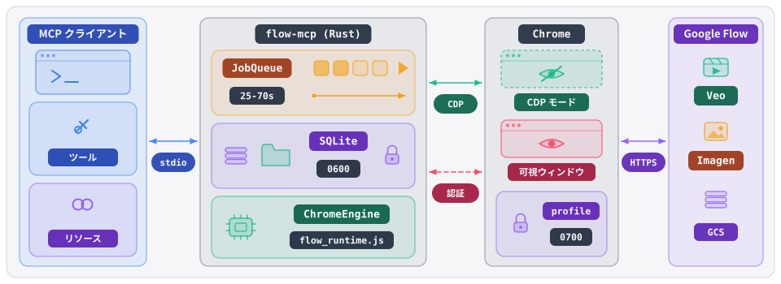
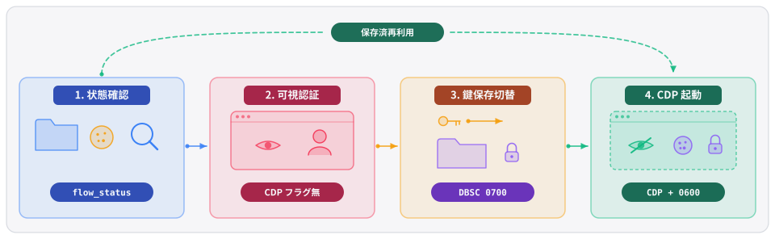
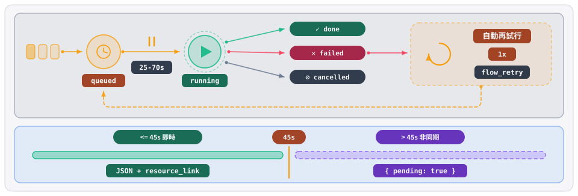
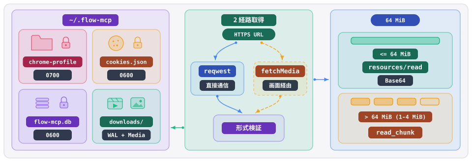

# アーキテクチャ

`flow-mcp` は、MCP stdio トランスポート、直列キュースケジューリング、ローカルストレージ、およびブラウザ制御を、TypeScript ランタイムを組み込んだ 1 つの静的 Rust バイナリへ配置します。

## 1. ランタイムレイヤーと TypeScript バンドル

| コンポーネント | モジュール | 役割 |
| :--- | :--- | :--- |
| MCP アダプター | `src/mcp.rs` | `rmcp` stdio を通じて MCP ツール（`tools/call`）および MCP リソース（`resources/list`、`resources/templates/list`、`resources/read`）を提供 |
| サービス統括 | `src/service.rs` | SQLite、`JobQueue`、`ChromeEngine` 間でツールリクエストをルーティング |
| 直列ワーカー | `src/queue.rs` | ランダム休止を挟みながら FIFO キュー上でブラウザ変更ジョブを 1 件ずつ実行 |
| ブラウザエンジン | `src/engine.rs`、`src/chrome.rs`、`src/cdp.rs` | `ManagedChrome`（CDP）、`LoginChrome`（可視・非 CDP）、WebSocket CDP RPC、および `Network` イベントを管理 |
| ブラウザランタイム | `ts/*.ts`（`build.rs`） | `esbuild` が 26 個のフラットな TypeScript モジュールを `OUT_DIR/flow_runtime.js` へバンドルし、`src/engine.rs` が単一埋め込みして `window.__flowMcp` を設定 |
| ローカル永続化 | `src/db.rs`、`src/cookies.rs`、`src/download.rs`、`src/platform.rs`、`src/instance.rs` | `flow-mcp.db`（`0600`）、`cookies.json`（`0600`）、`<home>/chrome-profile`（`0700`）、および `<home>/downloads` を管理 |

Google Flow ページ内部では、`ts/` は静的モックを使わず `lService` ストアからライブ Angular 状態（`read_store_snapshot.ts` と `discover_store.ts`）を読み取ります。変更処理の実行時、Rust はストア更新と、`aisandbox-pa.googleapis.com` および `batchexecute` 向けの CDP HTTP 応答（`is_flow_mutation_rpc_ok`）の両方を監視します。

すべてのブラウザセッションはインターフェース言語を英語（`hl=en` と `en-US`）に固定します。これにより、どのホスト環境でも Angular コントロール、メニューラベル、ボイス一覧が一貫して動作します。

## 2. デュアルモード Chrome と DBSC セッション引き継ぎ

Google 認証は、対話型サインイン中に Device Bound Session Credentials（DBSC）と自動操作シグナルを検査します。リモートデバッグフラグを有効にした可視 Chrome では、サインインや DBSC バインドが失敗しやすくなります。`ChromeEngine` は 2 つの分離されたブラウザモードでこの問題を回避します：

1. **`LoginChrome`（対話モード専用）**：
   - CDP フラグを**付けずに** `<home>/chrome-profile`（Unix 権限 `0700`）で標準の可視 Chrome を起動し、Google サインイン（`?hl=en`）を開きます。
   - `wait=true`（既定、`timeout_secs=180`）の間、`flow_login` は CDP 干渉なしでプロファイルディレクトリの Flow URL と Google Cookie を確認します。
   - サインイン終了後、`ChromeEngine::promote_login_chrome` は `LoginChrome` を停止します。続いて Chromium が Cookie と DBSC 鍵を `<home>/chrome-profile` へフラッシュします。
2. **`ManagedChrome`（既定のバックグラウンドモード）**：
   - `<home>/chrome-profile` 上でローカル WebSocket CDP 接続（`--cdp-port`、`FLOW_MCP_CDP_PORT`、またはポート `0`）付きのウィンドウ表示の Chrome（`--headless` 指定時はヘッドレス Chrome）を起動します。
   - ページ読み込み時に埋め込み済み `flow_runtime.js` IIFE バンドルを実行し、正規化済み Cookie を `<home>/cookies.json`（Unix 権限 `0600`）へ原子的に書き込みます。
3. **Cookie 正規化とネイティブプロファイル優先**：
   - 正規化では `google.com`、`labs.google`、`googleusercontent.com`、`gstatic.com` ドメインのみを保持し、`__Host-` プレフィックスと `hostOnly` フラグも維持します。
   - `<home>/chrome-profile` に有効なネイティブ Google Cookie がある場合、`flow-mcp` はそれらを変更せずに保持し、`<home>/cookies.json` の古いデータで上書きしません。
4. **単一インスタンスロックと孤立 Chrome**：
   - Chrome を起動する前に、`flow-mcp` は `<home>/flow-mcp.lock`（Unix 権限 `0600`）に排他ロックを取得し、プロセス終了まで保持します。プロセスが終了すると（クラッシュ時も含む）、OS がロックを解放します。
   - 別のプロセスがロックを保持している場合、Chrome の起動、`login`、`status`、`logout`、および `flow_login` の `logout` はエラーになります。`doctor` は警告を表示します。
   - ロックを保持している間、`<home>/chrome-profile` 上でこのプロセスが起動していない Chrome プロセスは孤立プロセスです。`flow-mcp` はまず通常終了を要求し（Unix では `SIGINT`、Windows では `taskkill`）、3 秒後も残っている場合は強制終了します。

## 3. `JobQueue` 直列化と 45 秒インライン待機

1 つの Google Flow Angular タブで並列編集を実行すると、UI 競合状態、アップロード欠落、および RPC 誤帰属が発生します。`JobQueue` は厳密な直列実行でこれらのエラーを防ぎます：

- **単一バックグラウンドワーカー**：生成、編集、動画延長、またはキャラクタージョブを一度に 1 件だけ実行します。完了済みジョブは最大 `200` 件までの FIFO 履歴リストに残ります。
- **ジョブ間のランダム休止**：次のジョブを開始する前に、ワーカーは `--pause` または `FLOW_MCP_PAUSE` で指定した範囲（既定 `25,70` 秒）のランダムな時間だけ休止します。
- **Agent モード自動リトライ**：ジョブが `"agent finished without creating"` で失敗し、かつ `retried_from` が `None` の場合、`JobQueue` は `retried_from` にその ID を設定したリトライジョブを 1 件キューに追加します。
- **インライン待機ウィンドウ（`PATIENCE_MS = 45_000`）**：多くの MCP クライアントは `60` 秒後にツール呼び出しをキャンセルします。`flow_wait` と `flow_download` は呼び出しごとに最大 `45` 秒まで待機してから `{"pending": true, ...}` を返すため、`flow_wait`、`flow_status`、または `flow_downloads` で再度ポーリングできます。

## 4. ストレージ境界と 2 経路ダウンロード

`flow-mcp` はすべての状態を 1 つの設定可能なルートディレクトリ（`--home <PATH>`、`FLOW_MCP_HOME`、または `~/.flow-mcp`）にプライベートな Unix 権限で保存します：

| `<home>` 配下のパス | Unix モード | 役割 |
| :--- | :--- | :--- |
| `chrome-profile/` | `0700` | 永続 Chrome プロファイル、DBSC 鍵、ライブセッション Cookie |
| `cookies.json` | `0600` | `flow-mcp` が原子的に書き込む正規化済み Google / Flow Cookie 配列 |
| `flow-mcp.lock` | `0600` | Chrome を起動できる間にプロセスが保持する単一インスタンスロック |
| `flow-mcp.db` | `0600` | `downloads`、`character_looks`、`characters` 用の `WAL` モード SQLite DB |
| `downloads/` | プライベートディレクトリ | すべてのダウンロードメディアの固定フォルダ（`flow-mcp` は外部出力パスを拒否します） |

### メディアダウンロードパイプライン（`flow_download` とジョブダウンロード）

1. **URL 解決**：`flow-mcp` はプロジェクトスナップショットから `fifeUrl`、`videoUrl`、または `imageUrl` を読み取ります。欠損時は Flow の `as29s` RPC を呼び出して署名付き URL を取得します。
2. **主 HTTP ストリーム（`reqwest`）**：`reqwest` はバイト列を一時ファイルへストリーミングします。署名付き CDN URL（`storage.googleapis.com` と `flow-content.google`）では Cookie ヘッダーを省き、Google URL には `Referer: https://flow.google.com/` と Chrome Cookie を送信します。
3. **ブラウザ `fetchMedia` フォールバック**：HTTP ストリームが失敗した場合、`ChromeEngine` は Flow ページ内で `fetchMedia` を実行し、Base64 結果をデコードします。
4. **検証と自然な命名**：`flow-mcp` は 0 バイトファイルを拒否し、`Content-Type` とマジックバイトを確認します。`Content-Disposition`、URL パス、または `<asset_id>.<ext>` からファイル名を選択し、重複名を解決して SQLite（`downloads`）を更新します。
5. **MCP リソース配信**：`flow-mcp` は各ダウンロードを `flow://downloads/{id}` と `flow://downloads/asset/{asset_id}` として登録します。`resources/list` は 1 ページ `100` 件を返します。`resources/read` は `64 MiB` までのファイルを Base64 として返し、より大きなファイルは `flow_downloads`（`action="read_chunk"`）がスライス単位で読み取ります。
