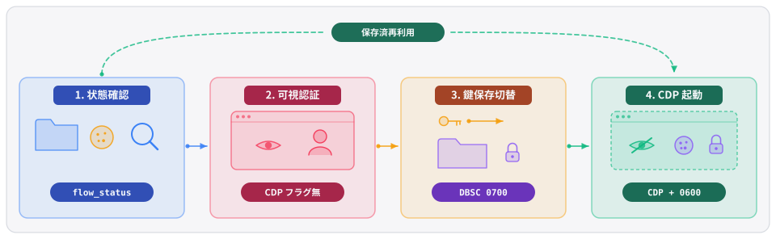

# クイックスタート

このガイドの手順に従い、`flow-mcp` を導入し、MCP クライアントを接続して Google Flow にサインインし、動画を生成してください。

## 事前準備

ホストマシンに次の項目を用意します：

- **Google Chrome または Chromium**：サインインおよび Flow 自動操作のため、実行時に Chrome または Chromium が必要です。自動検出でブラウザバイナリが見つからない場合は、`--chrome <PATH>` または `FLOW_MCP_CHROME` を設定してください。
- **Flow を利用できる Google アカウント**：[Google Flow](https://flow.google.com/?hl=en) を開ける Google アカウントを用意します。
- **Node.js `18` 以上**：`@flow-mcp/cli` を実行するために Node.js をインストールするか、[GitHub Releases](https://github.com/ByteLandTechnology/flow-mcp/releases) から単体バイナリをダウンロードします。

## 1. `flow-mcp` のインストール

次の 3 つの方法から 1 つを選択します：

- **方法 A — `npx` または `npm` で実行する（推奨）**：

```sh
npx -y @flow-mcp/cli --help
```

またはグローバルインストールして `PATH` へ `flow-mcp` を追加します：

```sh
npm install --global @flow-mcp/cli
flow-mcp --version
```

`npm` は対応するオプショナルパッケージ（`@flow-mcp/darwin-arm64`、`@flow-mcp/darwin-x64`、`@flow-mcp/linux-arm64`、`@flow-mcp/linux-x64`、`@flow-mcp/win32-arm64`、または `@flow-mcp/win32-x64`）をインストールします。`--omit=optional` や `--no-optional` は指定しないでください。

- **方法 B — ビルド済みバイナリをダウンロードする**：[GitHub Releases](https://github.com/ByteLandTechnology/flow-mcp/releases) からお使いの OS と CPU に合うファイルを取得します。Unix では `chmod +x flow-mcp` を実行したあと、`--version` を実行してください。

- **方法 C — ソースからビルドする**：Rust `1.88+`（2024 edition）と Node.js をインストールします。`npm ci` はコンパイル時に `ts/index.ts` をバンドルするため、`esbuild` と TypeScript をインストールします。

```sh
git clone https://github.com/ByteLandTechnology/flow-mcp.git
cd flow-mcp
npm ci
cargo build --release
./target/release/flow-mcp --help
```

## 2. MCP クライアントの設定

MCP stdio クライアント設定（`mcpServers`）へ `flow-mcp` を追加します：

```json
{
  "mcpServers": {
    "flow-mcp": {
      "command": "npx",
      "args": [
        "-y", "@flow-mcp/cli", "serve",
        "--home", "/path/to/.flow-mcp"
      ],
      "env": {
        "FLOW_MCP_PAUSE": "25,70"
      }
    }
  }
}
```

単体バイナリを使う場合は、`"command"` にバイナリパス（たとえば `/usr/local/bin/flow-mcp`）を設定します。`"args"` には `["serve", "--home", "/path/to/.flow-mcp"]` を渡してください。

他のコンピューターから接続するには、サーバーでトークン付きの HTTP モードを起動し、URL をクライアントに追加します。Claude Code の例：

```sh
FLOW_MCP_HTTP_TOKEN=<十分に長いランダムなトークン> flow-mcp serve --http 0.0.0.0:8765
claude mcp add --transport http flow-mcp http://<サーバーのIP>:8765/mcp --header "Authorization: Bearer <十分に長いランダムなトークン>"
```

HTTP オプションとセキュリティ規則は[ツールリファレンス](tools-reference.md#http-トランスポート)を参照してください。

## 3. 初回サインインの完了

`flow-mcp` は既定でウィンドウ表示の CDP Chrome を実行します。ジョブ実行中はそのウィンドウを閉じたり操作したりしないでください。Google へサインインする必要がある場合、CDP フラグなしの標準的な可視 Chrome ウィンドウを開きます。



MCP クライアントから次の手順を順番に実行します：

1. `flow_status` でセッション状態を確認します：

```json
{
  "probe": false
}
```

`signed_in` が `true` の場合は、手順 2 をスキップします。

2. `flow_login` でサインインを開始します：

```json
{
  "action": "login",
  "wait": true,
  "timeout_secs": 180
}
```

可視 Chrome ウィンドウ上で Google サインインを完了してください。サインイン後に `flow-mcp` は可視ウィンドウを閉じ、`<home>/chrome-profile` へ状態をフラッシュします。続いて同じプロファイルでバックグラウンドの CDP Chrome を起動し、Google Flow ワークスペースセッションを検証します。

ターミナルから `flow-mcp login --home /path/to/.flow-mcp` を実行してサインインすることもできます。2 つの `flow-mcp` プロセスは同じ Chrome プロファイルを同時に使用できないため、先に MCP クライアントを停止してください。結果は `flow-mcp status` で確認できます。

## 4. プロジェクトの作成と動画生成

1. `flow_new_project` でプロジェクトを作成して開きます：

```json
{
  "title": "Demo Reel"
}
```

2. `flow_generate` で動画ジョブをキューへ登録します：

```json
{
  "prompt": "Slow dolly shot over a sunlit bamboo forest in morning mist",
  "mode": "video",
  "model": "veo-3.1-fast",
  "aspect": "16:9",
  "count": 2,
  "download": true
}
```

`flow_generate` は `id` と `status: "queued"` を持つ `JobView` オブジェクトを返します。

3. `flow_wait` でジョブの完了を待ちます：

```json
{
  "id": "<job_id>",
  "timeout": 600
}
```

`flow_wait` は 1 回の呼び出しあたり最大 `45` 秒まで待機します。`45` 秒時点でジョブがまだ実行中の場合、クライアントのタイムアウトを防ぐため `{"pending": true, "jobs": [...]}` を返します。`status` が `"done"` になるまで再度 `flow_wait` を呼び出してください。

4. `flow_downloads` でダウンロード済みファイルを一覧表示します：

```json
{
  "action": "list",
  "limit": 10
}
```

`flow-mcp` はすべてのダウンロードを `<home>/downloads` に保存し、リソース URI（たとえば `flow://downloads/1`）を割り当てます。`resources/read` に対応する MCP クライアントは `64 MiB` 以下のファイルを読み取れます。より大きなファイルには、`action="read_chunk"` を指定して `flow_downloads` を呼び出してください。

## トラブルシューティング

- **インストール状態を確認する**：`flow-mcp doctor` を実行すると、Chrome バイナリ、`<home>` とファイル権限、インスタンスロック、Google Flow のフロントエンドビルド、サインイン状態を確認できます。いずれかのチェックが失敗した場合、終了ステータス `1` で終了します。
- **ネイティブ実行ファイルパッケージがない**：`--omit=optional` および `--no-optional` を付けずに `@flow-mcp/cli` を再インストールしてください。
- **Chrome バイナリが見つからない**：`--chrome <PATH>` または `FLOW_MCP_CHROME` に Chrome または Chromium の実行ファイルパスを設定してください。
- **Google サインインの期限切れや拒否**：`{"action": "login", "force": true}` で `flow_login` を呼び出し、クリーンな Chrome ウィンドウを開きます。または `{"action": "logout"}` を呼び出して `<home>/chrome-profile` と `<home>/cookies.json` を削除します。
- **`45` 秒後に `{"pending": true}` が返る**：バックグラウンドジョブは継続しています。再度 `flow_wait` を呼び出すか、`flow_status` と `flow_downloads` を確認してください。

## 次のステップ

- `ChromeEngine`、`JobQueue`、およびストレージ境界の詳細は [アーキテクチャ](architecture.md) を参照してください。
- 動画、画像、キャラクター、編集、およびシーンの標準手順は [ワークフロー](workflows.md) を参照してください。
- すべてのパラメータとレスポンスフィールドは [ツールリファレンス](tools-reference.md) を参照してください。
