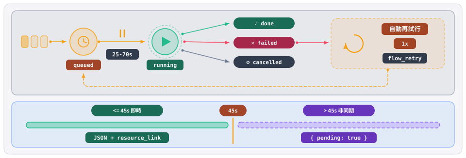

# ツールリファレンス

このページでは、`flow-mcp`（`v0.2.0`）の CLI フラグ、環境変数、MCP リソース、レスポンスオブジェクト、および全 22 個の MCP ツールを説明します。

## CLI オプション

```text
flow-mcp [OPTIONS]
```

| オプション | 効果 | 優先順位と既定値 |
| :--- | :--- | :--- |
| `--home <PATH>` | データルートディレクトリを設定する | `FLOW_MCP_HOME` に優先。既定は `~/.flow-mcp` |
| `--chrome <PATH>` | Chrome または Chromium バイナリのパスを設定する | `FLOW_MCP_CHROME` および OS 検出に優先 |
| `-h`, `--help` | CLI ヘルプを表示して終了する | — |
| `-V`, `--version` | `flow-mcp 0.2.0` を表示して終了する | — |

## 環境変数

| 変数 | 効果 | 既定値と範囲 |
| :--- | :--- | :--- |
| `FLOW_MCP_HOME` | `flow-mcp.db`、`downloads/`、`cookies.json`、`chrome-profile/` のルートディレクトリ | `~/.flow-mcp` |
| `FLOW_MCP_CHROME` | Chrome または Chromium 実行ファイルのパスを上書きする | OS パスおよび Playwright キャッシュ |
| `FLOW_MCP_CHROME_CDP_PORT` | ローカル Chrome DevTools Protocol TCP ポートを固定する | エフェメラルポート（`0`）、正の `u16` |
| `FLOW_MCP_PAUSE_MIN_S` | キュー実行ジョブ間の最小ランダム遅延（秒） | `25`（`0.0..=86400.0`） |
| `FLOW_MCP_PAUSE_MAX_S` | キュー実行ジョブ間の最大ランダム遅延（秒） | `70`（`0.0..=86400.0`、最小値以上） |

## MCP リソース仕様

- **`resources/list`**：`<home>/downloads` 上の既存ファイルを返します（1 ページ `100` エントリ、`cursor` は整数オフセット文字列）。`flow://downloads/<id>` URI、MIME タイプ、バイトサイズを含みます。
- **`resources/templates/list`**：`flow://downloads/{id}`（SQLite 行 ID）と `flow://downloads/asset/{asset_id}`（Flow アセット ID の最新ダウンロード）を公開します。
- **`resources/read`**：`64 MiB` 以下のファイルに対して Base64 `blob` ペイロードと MIME タイプを返します。より大きなファイルでは invalid-params エラーを返し、`flow_downloads` `action="read_chunk"` を案内します。
- **`resource_link` ブロック**：クライアントが MCP プロトコル `2025-06-18` 以降をネゴシエートした場合（またはバージョンを省略した場合）、`flow_download` は JSON ペイロードに加えて `resource_link` ブロックを追加します。

## 共通レスポンスオブジェクト



- **`JobView`**（`flow_generate`、`flow_agent_images`、`flow_edit`、`flow_video` `extend`、`flow_character`、`flow_character_edit`、`flow_wait`、`flow_cancel`、`flow_retry`）：
  - フィールド：`id`（8 文字文字列）、`status`（`"queued"`、`"running"`、`"done"`、`"failed"`、`"cancelled"`）、`prompt`、`name?`、`mode?`、`model?`、`created_at?`、`started_at?`、`finished_at?`（Unix ミリ秒）、`progress?`、`files?`、`created?`、`resources?`、`error?`、`retried_from?`。
- **`DownloadRecord`**（`flow_download`、`flow_downloads`）：
  - フィールド：`id`、`asset_id`、`project_id?`、`project_title?`、`name`、`kind`、`prompt?`、`source_url?`、`file_path`、`file_name`、`mime_type?`、`size_bytes`、`asset_created_at?`、`downloaded_at`（Unix ミリ秒）、`exists`（bool）、`resource_uri`（`flow://downloads/<id>`）。

---

## 1. セッション・プロジェクトツール

### `flow_status`

Google Flow 認証状態、アクティブプロジェクト、`JobQueue`、SQLite インデックス件数、Chrome 準備状態を確認します。

| パラメータ | 型 | 必須 | 説明 |
| :--- | :--- | :--- | :--- |
| `probe` | `boolean` | いいえ | ページ遷移なしで現在の Chrome ページを確認する場合は `true` を設定します。既定は `false`。 |

`{ flow: FlowStatus, queue: [...], downloads_count, home, db_path, downloads_dir, cookies_saved, profile_dir, ... }` を返します。プロジェクトを自動的に開いたり作成したりしません。

### `flow_login`

Chrome 経由でサインインするか、Flow Cookie を管理します。

| パラメータ | 型 | 必須 | 説明 |
| :--- | :--- | :--- | :--- |
| `action` | `string` | いいえ | `"login"`（`"start"`・既定）、`"sync_cookies"`（`"import_cookies"`）、`"save_cookies"`、`"status"`、または `"logout"`（`"reset_session"`、`"clear_cookies"`）。 |
| `wait` | `boolean` | いいえ | `"login"` 時にサインイン完了まで Chrome をポーリングします。既定は `true`。 |
| `timeout_secs` | `integer` | いいえ | `wait=true` 時の最大待機秒数。既定は `180`。 |
| `force` | `boolean` | いいえ | `LoginChrome` 開始前に保存済み Cookie とプロファイルを削除します。既定は `false`。 |
| `cookies` | `object[]` | いいえ | `"sync_cookies"` 用の Cookie 配列。このフィールドを省略すると、`flow-mcp` は `<home>/cookies.json` を読み込みます。 |

### `flow_new_project`

Flow ホームページを開き、プロジェクトを作成して、必要に応じてタイトルを設定します。`created`、`clicked`、`project_id`、`title`、`url` を返します。

| パラメータ | 型 | 必須 | 説明 |
| :--- | :--- | :--- | :--- |
| `title` | `string` | いいえ | 作成後に `flow-mcp` が適用するプロジェクトタイトル。 |

### `flow_projects`

Google Flow プロジェクトを一覧表示、作成、開く、名前変更、または削除します。

| パラメータ | 型 | 必須 | 説明 |
| :--- | :--- | :--- | :--- |
| `action` | `string` | いいえ | `"list"`（既定）、`"create"`、`"open"`、`"rename"`、または `"delete"`。 |
| `id` | `string` | いいえ | `"open"`、`"rename"`、または `"delete"` 用の対象プロジェクト ID。 |
| `title` | `string` | いいえ | `"create"` または `"rename"` 用の新しいタイトル、あるいは `"open"` / `"delete"` 用の大文字小文字を区別しないタイトル一致。 |

---

## 2. キャラクター・ボイスツール

### `flow_voices`

Google Flow でキャラクターボイスピッカーを開き、利用可能なボイスを一覧表示します。

| パラメータ | 型 | 必須 | 説明 |
| :--- | :--- | :--- | :--- |
| `character` | `string` | いいえ | ボイスピッカーを開くための任意の対象キャラクター ID または名前。 |

### `flow_character`

`JobQueue` へキャラクター作成ジョブを登録し、メタデータ（`id`、`project_id`、`name`、`bio`、`voice`、`ref_asset_ids`）を SQLite に保存します。`JobView` を返します。

| パラメータ | 型 | 必須 | 説明 |
| :--- | :--- | :--- | :--- |
| `name` | `string` | はい | キャラクター表示名。 |
| `description` | `string` | いいえ | 外見説明。`bio` を省略すると、`flow-mcp` はこのテキストを `bio` として使用します。 |
| `bio` | `string` | いいえ | 紹介文または性格メモ。 |
| `voice` | `string` | いいえ | ボイス名（たとえば `"Kore"`、`"Charon"`、または `flow_voices` から取得した名前）。 |
| `asset_ids` | `string[]` | いいえ | キャラクターの外見として添付する既存プロジェクト画像アセット ID。 |
| `refs` | `string[]` | いいえ | 外見としてアップロードするローカル参照画像ファイルパス。 |
| `prompt` | `string` | いいえ | エディタ内でキャラクター外見を生成するためのプロンプト。 |

### `flow_character_edit`

`/character/<id>` 用の更新ジョブを登録し、SQLite のキャラクターメタデータを更新します。`JobView` を返します。

| パラメータ | 型 | 必須 | 説明 |
| :--- | :--- | :--- | :--- |
| `name` | `string` | はい | 一致させる既存キャラクター ID または名前部分文字列。 |
| `new_name` | `string` | いいえ | 更新後の表示名。 |
| `bio` | `string` | いいえ | 更新後の紹介文またはメモ。 |
| `voice` | `string` | いいえ | 更新後のボイス名。 |
| `asset_ids` | `string[]` | いいえ | 外見として添付するプロジェクト画像アセット ID。 |
| `refs` | `string[]` | いいえ | アップロードするローカル参照画像パス。 |
| `prompt` | `string` | いいえ | キャラクターエディタ内での編集または外見生成プロンプト。 |

### `flow_characters`

アクティブプロジェクト内のキャラクターを一覧表示します。ライブ Flow タイルと SQLite に保存された `bio`、`voice`、`ref_asset_ids` フィールドを統合します。パラメータは不要です。

---

## 3. 生成・編集ツール

### `flow_generate`

`JobQueue` へ Veo 動画または Imagen 画像の生成ジョブを登録します。`JobView` を返します。

| パラメータ | 型 | 必須 | 説明 |
| :--- | :--- | :--- | :--- |
| `prompt` | `string` | はい | `flow-mcp` が Google Flow へ送信するテキストプロンプト。 |
| `mode` | `string` | いいえ | `"video"`（既定）または `"image"`。 |
| `model` | `string` | いいえ | モデル上書き。既定は `"veo-3.1-fast"`（`video`）または `"nano-banana-2"`（`image`）。 |
| `aspect` | `string` | いいえ | アスペクト比：`"16:9"`（既定）、`"9:16"`、または `"1:1"`。 |
| `count` | `integer` | いいえ | 出力バッチ数（`1..=4`）。既定は `2`。 |
| `frames` | `string[]` | いいえ | 送信前にアップロードするローカル参照またはキーフレーム画像パス。 |
| `asset_ids` | `string[]` | いいえ | 素材またはフレームとして添付する既存プロジェクト画像アセット ID。 |
| `characters` | `string[]` | いいえ | プロンプトコントロールへ添付するキャラクター ID または名前。 |
| `video_type` | `string` | いいえ | 動画生成モード：`"frames"` または `"ingredients"`。 |
| `duration` | `string` | いいえ | 動画尺設定（たとえば `"5s"` または `"8s"`）。 |
| `resolution` | `string` | いいえ | 動画解像度設定（たとえば `"720p"`、`"1080p"`、または `"4K"`）。 |
| `name` | `string` | いいえ | ジョブ用の任意のシーンまたはアセットラベル。 |
| `download` | `boolean` | いいえ | 完了時に生成アセットを `<home>/downloads` へダウンロードします。既定は `true`。 |
| `character_role` | `string` | いいえ | SQLite `character_looks` のキー。`prompt` へ `", character {role}: {look}"` を追加します。 |
| `character_look` | `string` | いいえ | `character_role` の下で外見テキストを SQLite に保存し、`prompt` へ追加します。 |

### `flow_agent_images`

Flow Agent モードバッチ画像ジョブを登録します（`mode="image"`、`480` 秒待機ウィンドウ、`"agent finished without creating"` で `1x` リトライ）。`JobView` を返します。

| パラメータ | 型 | 必須 | 説明 |
| :--- | :--- | :--- | :--- |
| `prompt` | `string` | はい | Flow Agent モード用のバッチ画像プロンプト。 |
| `model` | `string` | いいえ | モデル上書き。既定は `"nano-banana-2"`。 |
| `aspect` | `string` | いいえ | アスペクト比（既定 `"16:9"`、`"9:16"`、または `"1:1"`）。 |
| `count` | `integer` | いいえ | 出力数（`1..=4`）。既定は `2`。 |

### `flow_edit`

UI 編集トリガーまたは `/edit/<id>` を通じて既存の画像または動画アセットの編集ジョブを登録します。`JobView` を返します。

| パラメータ | 型 | 必須 | 説明 |
| :--- | :--- | :--- | :--- |
| `match` | `string` | はい | ソースアセットに一致する大文字小文字を区別しないアセット ID、名前、またはプロンプト部分文字列。 |
| `prompt` | `string` | はい | 一致したアセットに対する編集指示。 |

---

## 4. 動画・シーンツール

### `flow_video`

非破壊トリムを適用するか、動画延長ジョブをキューへ登録します。

| パラメータ | 型 | 必須 | 説明 |
| :--- | :--- | :--- | :--- |
| `action` | `string` | はい | `"trim"`（即時 RPC 更新）または `"extend"`（`JobQueue` ジョブを登録して `JobView` を返す）。 |
| `match` | `string` | はい | 動画アセット ID、完全一致名、または大文字小文字を区別しない部分文字列。 |
| `start_seconds` | `number` | いいえ | `"trim"` 用の開始タイムスタンプ秒（`null` で開始境界をクリア）。 |
| `end_seconds` | `number` | いいえ | `"trim"` 用の終了タイムスタンプ秒（`null` で終了境界をクリア）。 |
| `prompt` | `string` | いいえ | `"extend"` 用の延長プロンプト。 |
| `scene_id` | `string` | いいえ | 延長先とする任意の既存シーン ID。 |

### `flow_scenes`

Flow シーンタイムラインの一覧表示、作成、クリップ追加、名前変更、またはゴミ箱移動を行います。

| パラメータ | 型 | 必須 | 説明 |
| :--- | :--- | :--- | :--- |
| `action` | `string` | いいえ | `"list"`（既定）、`"create"`、`"add_clips"`、`"rename"`、または `"trash"`。 |
| `id` | `string` | いいえ | 対象シーン ID（`"add_clips"` と `"rename"` に必要、`"trash"` では任意）。 |
| `name` | `string` | いいえ | `"create"` や `"rename"` 用のシーン名、または `"trash"` 用の任意一致文字列。 |
| `asset_ids` | `string[]` | いいえ | ソースクリップアセット ID（`"create"` では任意、`"add_clips"` では空でない配列が必要）。 |
| `position` | `integer` | いいえ | `"add_clips"` 用の挿入クリップインデックス。 |

---

## 5. キュー制御ツール

### `flow_wait`

キュー待機中または実行中のジョブ完了を待ちます。1 回の呼び出しあたり最大 `45` 秒（`PATIENCE_MS`）ブロックし、実行継続中であれば `{"pending": true, "jobs": [...]}` を返します。

| パラメータ | 型 | 必須 | 説明 |
| :--- | :--- | :--- | :--- |
| `ids` | `string[]` | いいえ | 待機する特定の 8 文字ジョブ ID。`ids` と `id` を両方省略すると、`flow-mcp` はすべてのジョブを待機します。 |
| `id` | `string` | いいえ | `ids` を省略したときの単一ジョブ ID。 |
| `timeout` | `integer` | いいえ | 最大総待機目標（秒）。既定は `600`、内部上限は `24` 時間。 |

### `flow_cancel`

`"queued"` ジョブを直ちに削除するか、`"running"` ジョブを停止します。未知の ID では失敗します。

| パラメータ | 型 | 必須 | 説明 |
| :--- | :--- | :--- | :--- |
| `id` | `string` | はい | `JobQueue` の 8 文字ジョブ ID。 |

### `flow_retry`

`retried_from` に `id` を設定して、失敗またはキャンセル済みジョブを再度キューへ登録します。未知の ID では失敗します。

| パラメータ | 型 | 必須 | 説明 |
| :--- | :--- | :--- | :--- |
| `id` | `string` | はい | 元の 8 文字ジョブ ID。 |

---

## 6. ライブラリ・コレクション・ダウンロードツール

### `flow_assets`

Flow Angular `lService` スナップショットから読み取ったプロジェクトタイルを一覧表示します。

| パラメータ | 型 | 必須 | 説明 |
| :--- | :--- | :--- | :--- |
| `query` | `string` | いいえ | アセット ID、名前、またはプロンプトに一致する大文字小文字を区別しない部分文字列。 |
| `kind` | `string` | いいえ | `"image"`、`"video"`、`"scene"`、`"character"`、または `"all"`（既定）で絞り込みます。 |
| `collection` | `string` | いいえ | コレクション ID、名前部分文字列、`"all"`、`"none"`、または `"uncollected"` で絞り込みます。 |
| `limit` | `integer` | いいえ | 返す最大項目数（`>= 1`）。 |

### `flow_rename`

アセット、キャラクター、シーン、またはコレクションを一括リネームし、RPC またはスナップショットで確認します。

| パラメータ | 型 | 必須 | 説明 |
| :--- | :--- | :--- | :--- |
| `items` | `object[]` | はい | `{"id": "...", "name": "..."}` エントリの空でない配列。 |

### `flow_collections`

プロジェクトコレクションの一覧表示、作成、名前変更、追加、除外、または削除を行います。

| パラメータ | 型 | 必須 | 説明 |
| :--- | :--- | :--- | :--- |
| `action` | `string` | はい | `"list"`、`"create"`、`"rename"`、`"add"`、`"remove"`、または `"delete"`。 |
| `name` | `string` | いいえ | `"create"` または `"delete"` 用のコレクション名。 |
| `from` | `string` | いいえ | `"rename"` または `"delete"` 用の既存コレクション ID または名前。 |
| `to` | `string` | いいえ | `"rename"` 用の新しいコレクション名。 |
| `collection` | `string` | いいえ | `"add"` または `"delete"` 用の対象コレクション ID または名前（`"add"` は存在しない場合に作成します）。 |
| `ids` | `string[]` | いいえ | コレクションへ移動（`"add"`）または除外（`"remove"`）する正確なアセットまたはキャラクター ID。 |

### `flow_download`

一致するプロジェクトの画像または動画を `<home>/downloads` へダウンロードし、`flow-mcp.db` に登録します。最大 `45` 秒まで待機し（タイムアウト時は `pending: true`）、`{"file", "resource_uri", "record"}` を返します。クライアントが MCP `2025-06-18` 以降に対応している場合は、`resource_link` も返します。

| パラメータ | 型 | 必須 | 説明 |
| :--- | :--- | :--- | :--- |
| `match` | `string` | はい | プロジェクトアセットに一致する正確なアセット ID、完全一致名、または大文字小文字を区別しない部分文字列。 |

### `flow_downloads`

`<home>/downloads` と `flow-mcp.db` 内の登録済みダウンロードを検索、確認、Base64 スライス読取、整理、削除、または消去します。

| パラメータ | 型 | 必須 | 説明 |
| :--- | :--- | :--- | :--- |
| `action` | `string` | いいえ | `"list"`（既定）、`"get"`、`"read_chunk"`、`"delete"`、`"prune"`、または `"clear"`。 |
| `id` | `integer` | いいえ | `"get"`、`"read_chunk"`、または `"delete"` 用の SQLite ダウンロード行 ID（`>= 1`）。 |
| `asset_id` | `string` | いいえ | `"get"`、`"read_chunk"`、または `"delete"` 用の Flow アセット ID。 |
| `query` | `string` | いいえ | ID、名前、プロンプト、ファイル名、またはパスに一致する大文字小文字を区別しない部分文字列（`"list"`）。 |
| `kind` | `string` | いいえ | `"list"` 用のフィルタ：`"image"`、`"video"`、`"scene"`、`"character"`、または `"all"`（既定）。 |
| `project_id` | `string` | いいえ | `"list"` 用のプロジェクト ID フィルタ。 |
| `existing_only` | `boolean` | いいえ | `"list"` 時にディスク上に存在するファイルの行のみを返します。既定は `false`。 |
| `limit` | `integer` | いいえ | `"list"` 用のページ上限（`1..=500`、既定 `50`）。 |
| `offset` | `integer` | いいえ | `"read_chunk"` 用の開始バイトオフセット。既定は `0`。 |
| `length` | `integer` | いいえ | `"read_chunk"` 用のスライスバイト長（`1..=4194304`、既定 `1048576` / `1 MiB`）。 |
| `older_than_days` | `integer` | いいえ | `action="clear"` 時の経過日数フィルタ。 |

### `flow_trash`

Google Flow 内で一致するアセット、キャラクター、シーン、またはコレクションをゴミ箱へ移動します。

| パラメータ | 型 | 必須 | 説明 |
| :--- | :--- | :--- | :--- |
| `match` | `string` | はい | アセットまたはコレクションの ID、名前、またはプロンプトに一致する大文字小文字を区別しない部分文字列。 |
