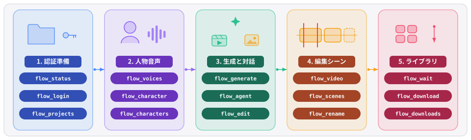
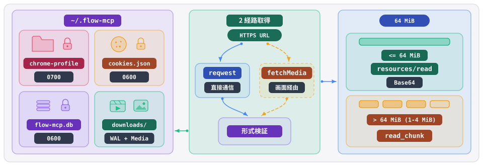

# ワークフロー

`flow-mcp` で動画・画像・キャラクター・編集・シーン・ライブラリ・ヘッドレス Cookie タスクを実行するには、次の手順に従ってください。



## 1. Veo 動画生成（テキスト、キーフレーム、素材）

`flow_generate` でテキストからの動画生成ジョブをキューへ登録します：

```json
{
  "prompt": "Low tracking shot of a red tram gliding across wet cobblestones at dusk",
  "mode": "video",
  "model": "veo-3.1-fast",
  "aspect": "16:9",
  "duration": "8s",
  "resolution": "1080p",
  "count": 2,
  "download": true
}
```

キーフレーム（`frames`）やプロジェクト素材（`asset_ids`）には `video_type`（`"frames"` または `"ingredients"`）を指定します：

```json
{
  "prompt": "Slow push-in as neon reflections ripple across the wet street",
  "mode": "video",
  "video_type": "frames",
  "frames": ["/abs/path/start-frame.png"],
  "asset_ids": ["existing_asset_id"],
  "aspect": "16:9",
  "count": 1
}
```

ジョブの完了を待ちます：

```json
{
  "id": "<job_id>",
  "timeout": 600
}
```

`flow_wait` の各呼び出しは最大 `45` 秒までブロックし、処理継続中は `{"pending": true, ...}` を返します。すべての対象ジョブが `"done"` に到達するまで再度 `flow_wait` を呼び出してください。

## 2. Imagen および Agent モードバッチ画像生成

標準的な画像生成（`mode="image"` の既定は `nano-banana-2`）：

```json
{
  "prompt": "Architectural cutaway of a serene timber library in soft morning light",
  "mode": "image",
  "model": "nano-banana-2",
  "aspect": "1:1",
  "count": 4
}
```

Flow Agent モードのバッチ画像生成には `flow_agent_images` を呼び出します。`480` 秒の待機ウィンドウを使用し、エラーに `"agent finished without creating"` が含まれる場合はリトライを 1 回追加します：

```json
{
  "prompt": "Create four consistent storyboard frames of a paper lantern festival by a canal",
  "model": "nano-banana-2",
  "aspect": "16:9",
  "count": 4
}
```

## 3. ショットをまたぐキャラクターの一貫性

`flow-mcp` は、ショット間でキャラクターを統一するための 2 つの方法を提供します：

1. **Flow キャラクターエンティティ（`flow_voices`、`flow_character`、`flow_character_edit`、`flow_characters`）**：
   - `flow_voices` を呼び出して利用可能なボイス（たとえば `"Kore"` や `"Charon"`）を一覧取得します。
   - 名前、説明、任意の紹介文、ボイス、ローカル `refs` パス、または `asset_ids` を渡して `flow_character` を呼び出します：

```json
{
  "name": "Captain Lin",
  "description": "Weather-worn navigator in a dark navy coat with a brass compass",
  "bio": "Calm veteran orbital tug pilot",
  "voice": "Charon",
  "refs": ["/abs/path/lin-portrait.png"]
}
```

   - 後続の `flow_generate` 呼び出しでは `"characters": ["Captain Lin"]` で保存済みキャラクターを添付します。
   - キャラクターを更新するには `flow_character_edit` を呼び出し、統合された Flow と SQLite の記録を一覧表示するには `flow_characters` を呼び出します。

2. **軽量プロンプトルック（`character_role` と `character_look`）**：
   - `flow_generate` に `"character_role": "courier"` と `"character_look": "yellow rain parka, scuffed boots"` を一度渡します。
   - `flow-mcp` はこのペアを SQLite（`character_looks`）に保存します。以降の `flow_generate` 呼び出しで `"character_role": "courier"` を渡すと、`flow-mcp` は `", character courier: yellow rain parka, scuffed boots"` を末尾に追加します。

## 4. アセット編集、トリム、動画延長、シーン

- **既存の画像や動画を編集する（`flow_edit`）**：ID、名前、またはプロンプト部分文字列でアセットを一致させ、編集ジョブをキューへ登録します：

```json
{
  "match": "lantern festival",
  "prompt": "Replace dusk sky with deep starlight and warm reflections on the water"
}
```

- **元を変更せずに動画をトリムする（`flow_video` の `action="trim"`）**：ジョブをキューに入れず、`start_seconds` と `end_seconds` を即時適用します。境界をクリアするには `null` を渡してください：

```json
{
  "action": "trim",
  "match": "red tram",
  "start_seconds": 1.2,
  "end_seconds": 6.5
}
```

- **動画を延長する（`flow_video` の `action="extend"`）**：動画延長ジョブ（任意で既存の `scene_id` 内）をキューへ登録し、`JobView` を受け取ります：

```json
{
  "action": "extend",
  "match": "red tram",
  "prompt": "The tram turns past a clocktower into a busy square"
}
```

- **タイムラインを組み立てる（`flow_scenes`）**：シーンの一覧表示、任意の `asset_ids` 付きシーン作成、`add_clips` による `position` へのクリップ挿入、シーン名変更、またはゴミ箱移動を行います：

```json
{
  "action": "add_clips",
  "id": "<scene_id>",
  "asset_ids": ["clip_asset_1", "clip_asset_2"],
  "position": 0
}
```

## 5. プロジェクトライブラリ、コレクション、大容量ファイル取得



- **タイルの絞り込みと整理**：
  - `flow_assets` で検索します（`query`、`kind`、`collection`：コレクション ID、名前部分文字列、`"all"`、`"none"`、または `"uncollected"`、および `limit`）。
  - `flow_rename` で項目を一括リネームします：`{"items": [{"id": "asset_1", "name": "Shot 01 - Tram"}]}`。
  - `flow_collections` でコレクションを管理します（`action`：`"list"`、`"create"`、`"rename"`、`"add"`、`"remove"`、`"delete"`）。
- **MCP 経由でのダウンロードとファイル読取**：
  - `flow_download`（`{"match": "Shot 01"}`）で必要なときにプロジェクトファイルをダウンロードします。
  - `flow_downloads` で `<home>/flow-mcp.db` 内の記録を管理します（`"list"`、`"get"`、`"delete"`、`"prune"`、または `older_than_days` 付きの `"clear"`）。
  - MCP `resources/read` は `64 MiB` を超えるファイルを拒否します。`flow_downloads`（`action="read_chunk"`）を使い、Base64 スライス（`1` バイト〜`4 MiB`、既定 `1 MiB`）で読み取ってください：

```json
{
  "action": "read_chunk",
  "id": 1,
  "offset": 0,
  "length": 1048576
}
```

## 6. ヘッドレスサーバーでの Cookie 同期と復旧

ディスプレイのない Linux サーバーで `flow-mcp` を実行する場合：

1. Chrome があるコンピュータ上で `flow_login`（`action="login"`）を一度実行してサインインします。
2. `<home>/cookies.json`（`0600`）をサーバーへコピーするか、ヘッドレスモードで Cookie を直接インポートします：

```json
{
  "action": "sync_cookies",
  "cookies": [
    {
      "name": "__Secure-1PSID",
      "value": "...",
      "domain": ".google.com",
      "path": "/"
    }
  ]
}
```

3. `action="sync_cookies"` で `"cookies"` を省略すると、サーバー上の `<home>/cookies.json` をヘッドレス Chrome へ再読み込みします。
4. `action="save_cookies"` を呼び出して Chrome Cookie を `cookies.json` へ保存するか、`action="logout"` を呼び出して `<home>/chrome-profile` と `cookies.json` を削除します。
