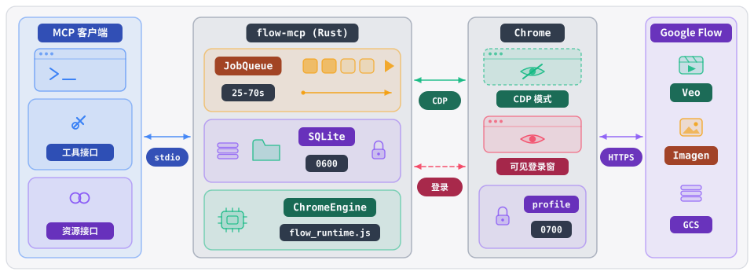
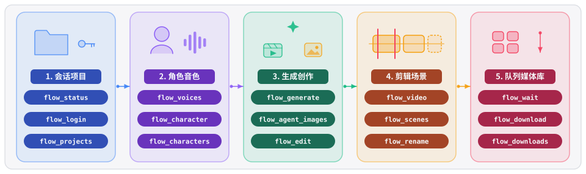

# flow-mcp

[](../../README.md)

[](../ja/README.md)

`flow-mcp` 是一个面向 Google Flow（`Veo` 与 `Imagen`）的 Rust 单二进制 stdio 模型上下文协议（MCP）服务端。它通过 `rmcp` 在标准输入和输出上提供 MCP 工具与下载资源。

`ChromeEngine` 管理位于 `<home>/chrome-profile`（Unix 权限 `0700`）的持久化 Chrome 或 Chromium 配置目录。后台执行时，它通过本地 Chrome DevTools Protocol（CDP）连接带可见窗口的 Chrome，因为 Google Flow 可能拒绝无头 Chrome 的生成请求。`--headless` 选项改用无头 Chrome（`--headless=new`）。在 `flow_login` 中进行 Google 登录时，它打开不带 CDP 标志的可见 Chrome 窗口。这让 Google 认证与设备绑定会话凭据（DBSC）正常完成。

单工作协程 `JobQueue` 按每次一个的方式串行执行生成、编辑、视频续写与角色任务，并在任务之间随机暂停。它将媒体文件按自然文件名下载到 `<home>/downloads`，并在 SQLite 中建立索引。



## 快速安装

在宿主机上安装 Node.js `18` 或更高版本，以及 Google Chrome 或 Chromium：

```sh
npx -y @flow-mcp/cli@latest --help
```

或者全局安装 CLI：

```sh
npm install --global @flow-mcp/cli
flow-mcp --help
```

运行 `flow-mcp doctor` 可检查 Chrome 二进制文件、`<home>` 权限、线上 Google Flow 前端构建以及登录状态；任一检查失败时退出状态码为 `1`。

安装 `@flow-mcp/cli` 时，`npm` 会一并安装匹配的可选平台包（`@flow-mcp/darwin-arm64`、`@flow-mcp/darwin-x64`、`@flow-mcp/linux-arm64`、`@flow-mcp/linux-x64`、`@flow-mcp/win32-arm64` 或 `@flow-mcp/win32-x64`）。Linux 预编译包使用 `glibc`。在 `musl` 系统（例如 Alpine Linux）上，请从源码编译。

> [!IMPORTANT]
> 请勿传入 `--omit=optional` 或 `--no-optional`。这些标志会跳过原生二进制包。宿主机在运行时也需要安装 Google Chrome 或 Chromium。

你也可以从 [GitHub Releases](https://github.com/ByteLandTechnology/flow-mcp/releases) 下载独立二进制文件：

| 平台 | x86_64 | ARM64 |
| :--- | :--- | :--- |
| macOS | `flow-mcp-macos-x86_64` | `flow-mcp-macos-arm64` |
| Linux | `flow-mcp-linux-x86_64` | `flow-mcp-linux-arm64` |
| Windows | `flow-mcp-windows-x86_64.exe` | `flow-mcp-windows-arm64.exe` |

如需从源码编译，请安装 Rust `1.88`（或更高版本）与 Node.js。`esbuild` 在编译期打包 `ts/index.ts`，因此编译出的二进制文件在运行时不需要 Node.js：

```sh
git clone https://github.com/ByteLandTechnology/flow-mcp.git
cd flow-mcp
npm ci
cargo build --release
```

将 `@flow-mcp/cli` 添加到 MCP stdio 客户端配置（`mcpServers`）：

```json
{
  "mcpServers": {
    "flow-mcp": {
      "command": "npx",
      "args": ["-y", "@flow-mcp/cli@latest", "serve", "--home", "/path/to/.flow-mcp"],
      "env": {
        "FLOW_MCP_PAUSE": "25,70"
      }
    }
  }
}
```

## Agent 插件

安装 agent 插件后，agent 无需手动配置即可使用 `flow-mcp`。插件会注册 MCP 服务器，并附带 skill，涵盖工作前检查、一次性的 Google 登录、任务等待和点数安全。

Claude Code：

```sh
claude plugin marketplace add ByteLandTechnology/flow-mcp
claude plugin install flow-mcp
```

Codex（把同一个仓库添加为 marketplace）：

```sh
codex plugin marketplace add ByteLandTechnology/flow-mcp
codex plugin add flow-mcp --marketplace flow-mcp
```

Antigravity（`agy`）：使用完整的 GitHub URL 安装插件。`ByteLandTechnology/flow-mcp` 这样的简写会失败。也可以传入本地克隆的路径：

```sh
agy plugin install https://github.com/ByteLandTechnology/flow-mcp
```

Google 登录需要真人在可见的 Chrome 窗口中操作一次，之后 agent 即可无需人工介入。

关于批准、并发会话和版本的注意事项，请阅读[快速入门](quickstart.md)。

## 文档目录

按任务类型阅读各章指南：

| 指南 | 类型 | 主要内容 |
| :--- | :--- | :--- |
| [快速开始](quickstart.md) | 教程 | 安装 `flow-mcp`、配置客户端、首次登录以及生成视频 |
| [架构设计](architecture.md) | 原理解析 | 双模式 `ChromeEngine`、DBSC 交接、`JobQueue`、45 秒等待上限、`<home>` 安全边界与 agent 插件 |
| [工作流指南](workflows.md) | 操作步骤 | 视频与图像任务、角色设置、编辑、场景、`read_chunk` 与 Cookie 同步 |
| [工具参考](tools-reference.md) | 参考手册 | CLI 选项、环境变量、MCP 资源与全部 MCP 工具 |

## 工具概览与媒体工作流



| 领域 | 工具 | 用途 |
| :--- | :--- | :--- |
| 会话与项目 | `flow_status`、`flow_login`、`flow_new_project`、`flow_projects` | 检查会话状态与前端构建兼容性、使用 Chrome 登录以及管理项目 |
| 角色与音色 | `flow_voices`、`flow_character`、`flow_character_edit`、`flow_characters`、`flow_voice_preview` | 列出 Flow 音色、创建或更新角色与自定义音色、试听音色并保存 SQLite 资料 |
| 生成与编辑 | `flow_generate`、`flow_edit` | 提交视频和图像生成任务或编辑资产 |
| Agent 对话 | `flow_agent` | 管理会话并与 Flow Agent 收发消息 |
| 视频与场景 | `flow_video`、`flow_scenes` | 在不修改源文件的情况下裁剪视频、续写片段并管理场景时间线 |
| 队列控制 | `flow_wait`、`flow_cancel`、`flow_retry` | 等待任务完成（`PATIENCE_MS = 45s`）、停止任务或重新运行失败任务 |
| 媒体库与下载 | `flow_assets`、`flow_rename`、`flow_collections`、`flow_download`、`flow_downloads`、`flow_trash` | 上传媒体、筛选资产、重命名项目、管理集合、下载文件、分片读取或移入回收站 |

阅读 [工具参考](tools-reference.md) 以查看每个参数与返回字段。
