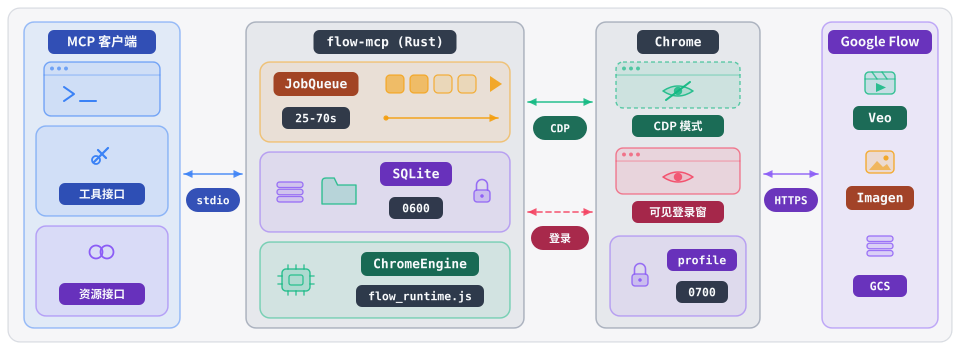
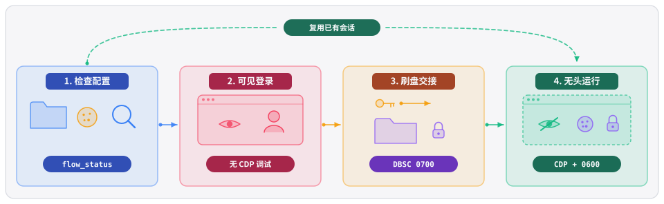
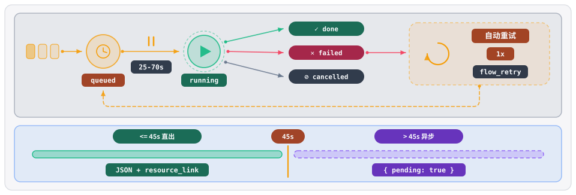
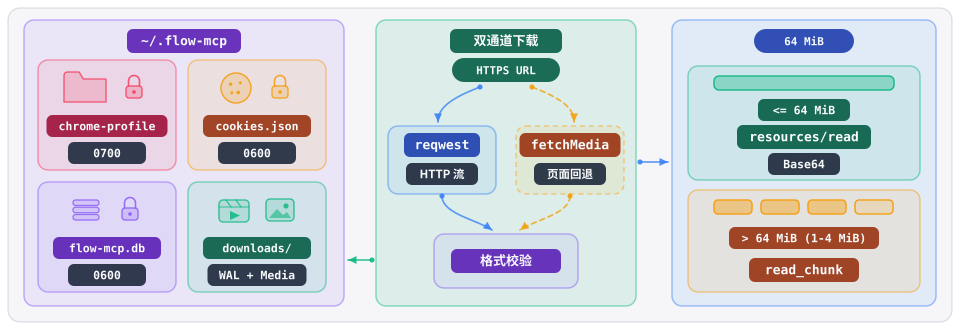

# 架构设计

`flow-mcp` 将 MCP stdio 传输、串行队列调度、本地存储与浏览器控制集成在一个静态 Rust 二进制文件中，并内嵌 TypeScript 运行时。

## 1. 运行时分层与 TypeScript 包

| 组件 | 模块 | 职责 |
| :--- | :--- | :--- |
| MCP 适配器 | `src/mcp.rs` | 通过 `rmcp` stdio 提供 MCP 工具（`tools/call`）与 MCP 资源（`resources/list`、`resources/templates/list`、`resources/read`） |
| 服务协调器 | `src/service.rs` | 在 SQLite、`JobQueue` 与 `ChromeEngine` 之间路由工具请求 |
| 串行工作器 | `src/queue.rs` | 在 FIFO 队列上每次运行一个浏览器变更任务，并在任务之间随机暂停 |
| 浏览器引擎 | `src/engine.rs`、`src/chrome.rs`、`src/cdp.rs` | 管理 `ManagedChrome`（CDP）、`LoginChrome`（可见无 CDP）、WebSocket CDP RPC 与 `Network` 事件 |
| 浏览器运行时 | `ts/*.ts`（`build.rs`） | `esbuild` 将 26 个扁平 TypeScript 模块打包为 `OUT_DIR/flow_runtime.js`；`src/engine.rs` 单次嵌入并设置 `window.__flowMcp` |
| 本地持久化 | `src/db.rs`、`src/cookies.rs`、`src/download.rs`、`src/platform.rs`、`src/instance.rs` | 管理 `flow-mcp.db`（`0600`）、`cookies.json`（`0600`）、`<home>/chrome-profile`（`0700`）与 `<home>/downloads` |

在 Google Flow 页面内部，`ts/` 从 `lService` 状态存储读取实时 Angular 状态（`read_store_snapshot.ts` 与 `discover_store.ts`），而不使用静态模拟数据。执行变更操作时，Rust 同时监控存储更新以及匹配 `aisandbox-pa.googleapis.com` 与 `batchexecute` 的 CDP HTTP 响应（`is_flow_mutation_rpc_ok`）。

所有浏览器会话均将界面语言固定为英语（`hl=en` 与 `en-US`）。这让 Angular 控件、菜单标签与音色列表在任意宿主机语言环境下保持一致。

## 2. 双模式 Chrome 与 DBSC 会话交接

Google 认证会在交互登录期间检查设备绑定会话凭据（DBSC）与自动化特征。开启远程调试标志的可见 Chrome 常会触发登录失败或 DBSC 绑定失败。`ChromeEngine` 通过两个独立浏览器模式解决此问题：

1. **`LoginChrome`（仅交互模式）**：
   - 使用 `<home>/chrome-profile`（Unix 权限 `0700`）启动**不带** CDP 标志的标准可见 Chrome，并打开 Google 登录页（`?hl=en`）。
   - 当 `wait=true`（默认，`timeout_secs=180`）时，`flow_login` 检查配置目录中的 Flow URL 与 Google Cookie，而不执行 CDP 探测。
   - 登录完成后，`ChromeEngine::promote_login_chrome` 停止 `LoginChrome`。随后 Chromium 将 Cookie 与 DBSC 密钥刷盘至 `<home>/chrome-profile`。
2. **`ManagedChrome`（默认后台模式）**：
   - 在 `<home>/chrome-profile` 上启动带可见窗口的 Chrome（使用 `--headless` 时为无头 Chrome），并建立本地 WebSocket CDP 连接（`--cdp-port`、`FLOW_MCP_CDP_PORT` 或随机端口 `0`）。
   - 在页面加载时执行内嵌的 `flow_runtime.js` IIFE 包，并将归一化后的 Cookie 原子写入 `<home>/cookies.json`（Unix 权限 `0600`）。
3. **Cookie 归一化与原生配置优先级**：
   - 归一化仅保留 `google.com`、`labs.google`、`googleusercontent.com` 与 `gstatic.com` 域名，同时保留 `__Host-` 前缀与 `hostOnly` 标志。
   - 如果 `<home>/chrome-profile` 已保存有效的原生 Google Cookie，`flow-mcp` 会原样保留它们，不会用 `<home>/cookies.json` 中的旧数据覆盖。
4. **单实例锁与孤儿 Chrome**：
   - 启动 Chrome 前，`flow-mcp` 会对 `<home>/flow-mcp.lock`（Unix 权限 `0600`）加独占锁，并持有到进程结束。进程结束时（包括崩溃），操作系统会释放该锁。
   - 若锁已被其他进程持有，启动 Chrome、`login`、`status`、`logout` 以及 `flow_login` 的 `logout` 操作都会报错，`doctor` 会显示警告。
   - 持有锁期间，`<home>/chrome-profile` 上任何不是由本进程启动的 Chrome 进程都视为孤儿进程。`flow-mcp` 会先请求其正常退出（Unix 上发送 `SIGINT`，Windows 上执行 `taskkill`），3 秒后仍未退出则强制结束。

## 3. `JobQueue` 串行化与 45 秒内联等待

在同一个 Google Flow Angular 标签页上并行执行修改会导致界面竞态条件、上传丢失与 RPC 归属错误。`JobQueue` 通过严格的串行执行消除这些错误：

- **单后台工作器**：同一时刻仅运行一个生成、编辑、视频续写或角色任务。已完成的任务留在最多保存 `200` 条记录的 FIFO 历史列表中。
- **任务之间随机暂停**：在开始下一条任务前，工作器会在 `--pause` 或 `FLOW_MCP_PAUSE` 指定的范围内（默认 `25,70` 秒）随机暂停一段时间。
- **Agent 对话轮次**：Agent 在独立的项目页面中运行。回复期间，Agent 与媒体任务共用同一把执行锁。
- **内联等待窗口（`PATIENCE_MS = 45_000`）**：许多 MCP 客户端会在 `60` 秒后取消工具调用。`flow_wait` 与 `flow_download` 每次最多等待 `45` 秒，随后返回 `{"pending": true, ...}`，以便你使用 `flow_wait`、`flow_status` 或 `flow_downloads` 继续轮询。

## 4. 存储边界与双路径下载

`flow-mcp` 将全部状态保存在一个可配置的根目录（`--home <PATH>`、`FLOW_MCP_HOME` 或 `~/.flow-mcp`）中，并设置私有 Unix 权限：

| `<home>` 下路径 | Unix 权限 | 职责 |
| :--- | :--- | :--- |
| `chrome-profile/` | `0700` | 持久化 Chrome 配置目录、DBSC 密钥与实时会话 Cookie |
| `cookies.json` | `0600` | `flow-mcp` 原子写入的归一化 Google 与 Flow Cookie 数组 |
| `flow-mcp.lock` | `0600` | 进程可启动 Chrome 期间持有的单实例锁 |
| `flow-mcp.db` | `0600` | `WAL` 模式 SQLite 数据库，包含 `downloads`、`character_looks` 与 `characters` |
| `downloads/` | 私有目录 | 全部下载媒体的固定目录；`flow-mcp` 拒绝外部输出路径 |

### 媒体下载流程（`flow_download` 与任务下载）

1. **URL 解析**：`flow-mcp` 从项目快照读取 `fifeUrl`、`videoUrl` 或 `imageUrl`。如果缺失，它调用 Flow `as29s` RPC 获取签名 URL。
2. **主 HTTP 流（`reqwest`）**：`reqwest` 将字节流式写入临时文件。对于签名 CDN URL（`storage.googleapis.com` 与 `flow-content.google`），它不附加 Cookie 请求头；对于 Google URL，它发送 `Referer: https://flow.google.com/` 与 Chrome Cookie。
3. **浏览器 `fetchMedia` 回退**：如果 HTTP 流失败，`ChromeEngine` 会在 Flow 页面内部运行 `fetchMedia` 并解码返回的 Base64 结果。
4. **校验与自然命名**：`flow-mcp` 拒绝空字节文件并校验 `Content-Type` 与文件魔数。它按 `Content-Disposition`、URL 路径或 `<asset_id>.<ext>` 选择文件名，处理重名冲突并更新 SQLite（`downloads`）。
5. **MCP 资源服务**：`flow-mcp` 将每个下载项注册为 `flow://downloads/{id}` 与 `flow://downloads/asset/{asset_id}`。`resources/list` 每页返回 `100` 条项目。`resources/read` 以 Base64 提供不超过 `64 MiB` 的文件，而 `flow_downloads`（`action="read_chunk"`）按分片读取更大的文件。
