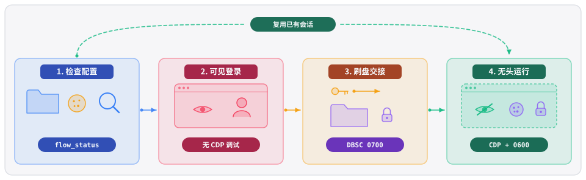

# 快速开始

按本指南步骤安装 `flow-mcp`、连接 MCP 客户端、登录 Google Flow 并生成视频。

## 准备工作

在宿主机上准备以下项目：

- **Google Chrome 或 Chromium**：运行时需要 Chrome 或 Chromium 来完成登录与 Flow 自动化。如果自动探测未找到浏览器二进制文件，请设置 `--chrome <PATH>` 或 `FLOW_MCP_CHROME`。
- **拥有 Flow 访问权限的 Google 账号**：准备一个可打开 [Google Flow](https://flow.google.com/?hl=en) 的 Google 账号。
- **Node.js `18` 或更高版本**：安装 Node.js 以运行 `@flow-mcp/cli`，或从 [GitHub Releases](https://github.com/ByteLandTechnology/flow-mcp/releases) 下载独立二进制文件。

## 1. 安装 `flow-mcp`

选择以下三种方式之一：

- **方式 A — 使用 `npx` 或 `npm` 运行（推荐）**：

```sh
npx -y @flow-mcp/cli --help
```

或者全局安装以将 `flow-mcp` 加入 `PATH`：

```sh
npm install --global @flow-mcp/cli
flow-mcp --version
```

`npm` 会安装对应的可选平台包（`@flow-mcp/darwin-arm64`、`@flow-mcp/darwin-x64`、`@flow-mcp/linux-arm64`、`@flow-mcp/linux-x64`、`@flow-mcp/win32-arm64` 或 `@flow-mcp/win32-x64`）。请勿传入 `--omit=optional` 或 `--no-optional`。

- **方式 B — 下载预编译二进制文件**：从 [GitHub Releases](https://github.com/ByteLandTechnology/flow-mcp/releases) 下载对应操作系统和 CPU 架构的文件。在 Unix 系统上运行 `chmod +x flow-mcp`，然后运行 `--version`。

- **方式 C — 从源码编译**：安装 Rust `1.88+`（2024 edition）与 Node.js。`npm ci` 会安装 `esbuild` 和 TypeScript，用于在编译期打包 `ts/index.ts`。

```sh
git clone https://github.com/ByteLandTechnology/flow-mcp.git
cd flow-mcp
npm ci
cargo build --release
./target/release/flow-mcp --help
```

## 2. 配置 MCP 客户端

将 `flow-mcp` 添加到 MCP stdio 客户端配置（`mcpServers`）：

```json
{
  "mcpServers": {
    "flow-mcp": {
      "command": "npx",
      "args": [
        "-y", "@flow-mcp/cli", "serve",
        "--home", "/path/to/.flow-mcp"
      ],
      "env": {
        "FLOW_MCP_PAUSE": "25,70"
      }
    }
  }
}
```

如果使用独立二进制文件，请将 `"command"` 设为二进制文件路径（例如 `/usr/local/bin/flow-mcp`）。并在 `"args"` 中传入 `["serve", "--home", "/path/to/.flow-mcp"]`。

若要从其他计算机连接，请在服务器上带令牌启动 HTTP 模式，然后把 URL 加到客户端。以 Claude Code 为例：

```sh
FLOW_MCP_HTTP_TOKEN=<足够长的随机令牌> flow-mcp serve --http 0.0.0.0:8765
claude mcp add --transport http flow-mcp http://<服务器IP>:8765/mcp --header "Authorization: Bearer <足够长的随机令牌>"
```

HTTP 选项与安全规则请参阅[工具参考](tools-reference.md#http-传输)。

### 可选：安装 Claude Code 插件

插件会注册 MCP 服务器，并附带一个 skill，教 agent 如何使用这些工具。skill 会检查会话状态，只在首次请求你登录 Google，循环等待任务完成，并在大量消耗点数前提醒。

```sh
claude plugin marketplace add ByteLandTechnology/flow-mcp
claude plugin install flow-mcp
```

在 Codex 中，把同一个仓库用作 marketplace：

```sh
codex plugin marketplace add ByteLandTechnology/flow-mcp
codex plugin add flow-mcp --marketplace flow-mcp
```

在 Antigravity（`agy`）中，克隆仓库后从目录安装插件：

```sh
agy plugin install /path/to/flow-mcp
```

完成一次登录（第 3 步）后，agent 即可无需人工介入地工作。

## 3. 完成首次登录

`flow-mcp` 默认运行带可见窗口的 CDP Chrome。任务运行期间不要关闭或操作该窗口。当你需要登录 Google 时，它会打开不带 CDP 标志的标准可见 Chrome 窗口。



从 MCP 客户端按顺序运行以下步骤：

1. 使用 `flow_status` 检查会话状态：

```json
{
  "probe": false
}
```

如果 `signed_in` 为 `true`，请跳过第 2 步。

2. 使用 `flow_login` 开始登录：

```json
{
  "action": "login",
  "wait": true,
  "timeout_secs": 180
}
```

在可见 Chrome 窗口中完成 Google 登录。登录完成后，`flow-mcp` 会关闭可见窗口并将数据刷盘到 `<home>/chrome-profile`。随后它会在同一配置目录上启动后台 CDP Chrome 并验证 Google Flow 工作区会话。

也可以在终端中运行 `flow-mcp login --home /path/to/.flow-mcp` 完成登录。请先停止 MCP 客户端，因为两个 `flow-mcp` 进程不能同时使用同一个 Chrome 配置目录。之后可运行 `flow-mcp status` 查看结果。

## 4. 创建项目并生成视频

1. 使用 `flow_new_project` 创建并打开项目：

```json
{
  "title": "Demo Reel"
}
```

2. 使用 `flow_generate` 将视频任务加入队列：

```json
{
  "prompt": "Slow dolly shot over a sunlit bamboo forest in morning mist",
  "mode": "video",
  "model": "veo-3.1-fast",
  "aspect": "16:9",
  "count": 2,
  "download": true
}
```

`flow_generate` 返回一个包含 `id` 与 `status: "queued"` 的 `JobView` 对象。

3. 使用 `flow_wait` 等待任务完成：

```json
{
  "id": "<job_id>",
  "timeout": 600
}
```

`flow_wait` 每次调用最多等待 `45` 秒。如果任务在 `45` 秒时仍在运行，它会返回 `{"pending": true, "jobs": [...]}` 以防止客户端超时。请再次调用 `flow_wait`，直到 `status` 变为 `"done"`。

4. 使用 `flow_downloads` 列出已下载文件：

```json
{
  "action": "list",
  "limit": 10
}
```

`flow-mcp` 将全部下载文件保存在 `<home>/downloads` 中并分配资源 URI（例如 `flow://downloads/1`）。支持 `resources/read` 的 MCP 客户端可直接读取不超过 `64 MiB` 的文件。对于更大的文件，请调用 `flow_downloads` 并传入 `action="read_chunk"`。

## 常见问题排查

- **检查安装状态**：运行 `flow-mcp doctor` 检查 Chrome 二进制文件、`<home>` 与文件权限、单实例锁、线上 Google Flow 前端构建以及登录状态。任一检查失败时退出状态码为 `1`。
- **缺少原生可执行文件包**：不带 `--omit=optional` 或 `--no-optional` 重新安装 `@flow-mcp/cli`。
- **未找到 Chrome 二进制文件**：将 `--chrome <PATH>` 或 `FLOW_MCP_CHROME` 设为 Chrome 或 Chromium 可执行文件路径。
- **Google 登录过期或遭拒绝**：调用 `flow_login` 传入 `{"action": "login", "force": true}` 以打开干净的 Chrome 窗口。或者调用 `{"action": "logout"}` 删除 `<home>/chrome-profile` 与 `<home>/cookies.json`。
- **调用在 `45` 秒后返回 `{"pending": true}`**：后台任务仍在继续运行。请再次调用 `flow_wait`，或检查 `flow_status` 与 `flow_downloads`。

## 下一步

- 阅读 [架构设计](architecture.md) 了解 `ChromeEngine`、`JobQueue` 与存储边界。
- 阅读 [工作流指南](workflows.md) 获取视频、图像、角色、编辑与场景的操作步骤。
- 阅读 [工具参考](tools-reference.md) 查看全部参数与返回字段。
