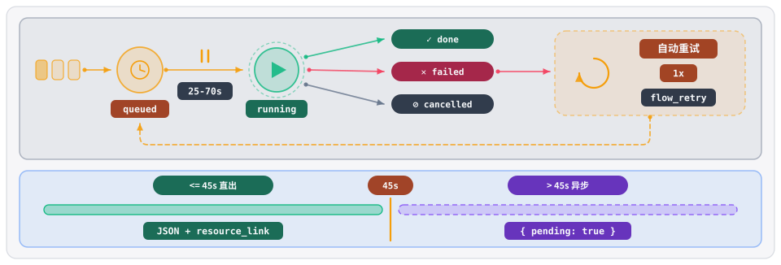

# 工具参考

本页记录 `flow-mcp`（`v0.2.0`）的 CLI 标志、环境变量、MCP 资源、返回对象以及全部 MCP 工具。

## CLI 选项

```text
flow-mcp [OPTIONS]
```

| 选项 | 作用 | 优先级与默认值 |
| :--- | :--- | :--- |
| `--home <PATH>` | 设置数据根目录 | 优先于 `FLOW_MCP_HOME`；默认为 `~/.flow-mcp` |
| `--chrome <PATH>` | 设置 Chrome 或 Chromium 二进制路径 | 优先于 `FLOW_MCP_CHROME` 与系统探测 |
| `-h`, `--help` | 输出 CLI 帮助并退出 | — |
| `-V`, `--version` | 输出 `flow-mcp 0.2.0` 并退出 | — |

## 环境变量

| 变量名 | 作用 | 默认值与范围 |
| :--- | :--- | :--- |
| `FLOW_MCP_HOME` | `flow-mcp.db`、`downloads/`、`cookies.json` 与 `chrome-profile/` 的根目录 | `~/.flow-mcp` |
| `FLOW_MCP_CHROME` | 覆盖 Chrome 或 Chromium 可执行文件路径 | 系统路径与 Playwright 缓存 |
| `FLOW_MCP_CHROME_CDP_PORT` | 固定本地 Chrome DevTools Protocol TCP 端口 | 临时端口（`0`）；正整数 `u16` |
| `FLOW_MCP_PAUSE_MIN_S` | 队列任务之间的最小随机延迟秒数 | `25`（`0.0..=86400.0`） |
| `FLOW_MCP_PAUSE_MAX_S` | 队列任务之间的最大随机延迟秒数 | `70`（`0.0..=86400.0`，不小于最小值） |

## MCP 资源规范

- **`resources/list`**：返回 `<home>/downloads` 中的现有文件（每页 `100` 条，`cursor` 为整数偏移量字符串），包含 `flow://downloads/<id>` URI、MIME 类型与字节大小。
- **`resources/templates/list`**：公开 `flow://downloads/{id}`（SQLite 行 ID）与 `flow://downloads/asset/{asset_id}`（Flow 资产 ID 对应的最新下载）。
- **`resources/read`**：为不超过 `64 MiB` 的文件返回 Base64 `blob` 数据与 MIME 类型。对于更大的文件，它返回无效参数错误并指引调用 `flow_downloads` `action="read_chunk"`。
- **`resource_link` 数据块**：当客户端协商 MCP 协议 `2025-06-18` 或更高版本（或省略版本号）时，`flow_download` 会在 JSON 返回旁添加 `resource_link` 数据块。

## 共享返回对象



- **`JobView`**（`flow_generate`、`flow_agent_images`、`flow_edit`、`flow_video` `extend`、`flow_character`、`flow_character_edit`、`flow_wait`、`flow_cancel`、`flow_retry`）：
  - 字段：`id`（8 位字符串）、`status`（`"queued"`、`"running"`、`"done"`、`"failed"`、`"cancelled"`）、`prompt`、`name?`、`mode?`、`model?`、`created_at?`、`started_at?`、`finished_at?`（Unix 毫秒）、`progress?`、`files?`、`created?`、`resources?`、`error?`、`retried_from?`。
- **`DownloadRecord`**（`flow_download`、`flow_downloads`）：
  - 字段：`id`、`asset_id`、`project_id?`、`project_title?`、`name`、`kind`、`prompt?`、`source_url?`、`file_path`、`file_name`、`mime_type?`、`size_bytes`、`asset_created_at?`、`downloaded_at`（Unix 毫秒）、`exists`（布尔值）、`resource_uri`（`flow://downloads/<id>`）。

---

## 1. 会话与项目工具

### `flow_status`

检查 Google Flow 认证状态、活动项目、`JobQueue`、SQLite 索引数以及 Chrome 就绪状态。

| 参数 | 类型 | 必填 | 说明 |
| :--- | :--- | :--- | :--- |
| `probe` | `boolean` | 否 | 设为 `true` 以在不跳转页面的情况下检查当前 Chrome 页面。默认 `false`。 |

返回 `{ flow: FlowStatus, queue: [...], downloads_count, home, db_path, downloads_dir, cookies_saved, profile_dir, ... }`。不会自动打开或创建项目。

### `flow_login`

通过 Chrome 登录或管理 Flow Cookie。

| 参数 | 类型 | 必填 | 说明 |
| :--- | :--- | :--- | :--- |
| `action` | `string` | 否 | `"login"`（`"start"`，默认）、`"sync_cookies"`（`"import_cookies"`）、`"save_cookies"`、`"status"` 或 `"logout"`（`"reset_session"`、`"clear_cookies"`）。 |
| `wait` | `boolean` | 否 | 在 `"login"` 时轮询 Chrome 直到登录完成。默认 `true`。 |
| `timeout_secs` | `integer` | 否 | `wait=true` 时的最长等待秒数。默认 `180`。 |
| `force` | `boolean` | 否 | 在启动 `LoginChrome` 前删除已保存的 Cookie 与配置目录。默认 `false`。 |
| `cookies` | `object[]` | 否 | 用于 `"sync_cookies"` 的 Cookie 数组。如果省略此字段，`flow-mcp` 会加载 `<home>/cookies.json`。 |

### `flow_new_project`

打开 Flow 首页，创建项目，并按需设置标题。返回 `created`、`clicked`、`project_id`、`title` 与 `url`。

| 参数 | 类型 | 必填 | 说明 |
| :--- | :--- | :--- | :--- |
| `title` | `string` | 否 | `flow-mcp` 在创建后应用的项目标题。 |

### `flow_projects`

列出、创建、打开、重命名或删除 Google Flow 项目。

| 参数 | 类型 | 必填 | 说明 |
| :--- | :--- | :--- | :--- |
| `action` | `string` | 否 | `"list"`（默认）、`"create"`、`"open"`、`"rename"` 或 `"delete"`。 |
| `id` | `string` | 否 | 用于 `"open"`、`"rename"` 或 `"delete"` 的目标项目 ID。 |
| `title` | `string` | 否 | 用于 `"create"` 或 `"rename"` 的新标题，或用于 `"open"` 与 `"delete"` 的忽略大小写标题匹配词。 |

---

## 2. 角色与音色工具

### `flow_voices`

在 Google Flow 中打开角色音色选择器并列出可用音色。

| 参数 | 类型 | 必填 | 说明 |
| :--- | :--- | :--- | :--- |
| `character` | `string` | 否 | 用于打开音色选择器的可选既有角色 ID 或名称。 |

### `flow_character`

在 `JobQueue` 上入队角色创建任务，并将元数据（`id`、`project_id`、`name`、`bio`、`voice`、`ref_asset_ids`）保存至 SQLite。返回 `JobView`。

| 参数 | 类型 | 必填 | 说明 |
| :--- | :--- | :--- | :--- |
| `name` | `string` | 是 | 角色显示名称。 |
| `description` | `string` | 否 | 外观描述。如果省略 `bio`，`flow-mcp` 将此文本用作 `bio`。 |
| `bio` | `string` | 否 | 简介或性格备注。 |
| `voice` | `string` | 否 | 音色名称（例如 `"Kore"`、`"Charon"` 或来自 `flow_voices` 的名称）。 |
| `asset_ids` | `string[]` | 否 | 作为角色外观附加的既有项目图像资产 ID。 |
| `refs` | `string[]` | 否 | 作为外观上传的本地参考图像文件路径。 |
| `prompt` | `string` | 否 | 在编辑器内生成角色外观的提示词。 |

### `flow_character_edit`

为 `/character/<id>` 入队更新任务并更新 SQLite 角色元数据。返回 `JobView`。

| 参数 | 类型 | 必填 | 说明 |
| :--- | :--- | :--- | :--- |
| `name` | `string` | 是 | 要匹配的既有角色 ID 或名称子串。 |
| `new_name` | `string` | 否 | 更新后的显示名称。 |
| `bio` | `string` | 否 | 更新后的简介或备注。 |
| `voice` | `string` | 否 | 更新后的音色名称。 |
| `asset_ids` | `string[]` | 否 | 作为外观附加的项目图像资产 ID。 |
| `refs` | `string[]` | 否 | 要上传的本地参考图像路径。 |
| `prompt` | `string` | 否 | 角色编辑器内的编辑或外观生成提示词。 |

### `flow_characters`

列出活动项目中的角色。将实时 Flow 卡片与 SQLite 中存储的 `bio`、`voice` 与 `ref_asset_ids` 字段合并返回。不接受参数。

---

## 3. 生成与编辑工具

### `flow_generate`

在 `JobQueue` 上入队 Veo 视频或 Imagen 图像生成任务。返回 `JobView`。

| 参数 | 类型 | 必填 | 说明 |
| :--- | :--- | :--- | :--- |
| `prompt` | `string` | 是 | `flow-mcp` 发送给 Google Flow 的文本提示词。 |
| `mode` | `string` | 否 | `"video"`（默认）或 `"image"`。 |
| `model` | `string` | 否 | 模型覆盖。默认为 `"veo-3.1-fast"`（`video`）或 `"nano-banana-2"`（`image`）。 |
| `aspect` | `string` | 否 | 画面比例：`"16:9"`（默认）、`"9:16"` 或 `"1:1"`。 |
| `count` | `integer` | 否 | 输出批次数量，范围 `1..=4`。默认 `2`。 |
| `frames` | `string[]` | 否 | 提交前上传的本地参考图像或关键帧路径。 |
| `asset_ids` | `string[]` | 否 | 作为素材或关键帧附加的既有项目图像资产 ID。 |
| `characters` | `string[]` | 否 | 附加到提示词控件的角色 ID 或名称。 |
| `video_type` | `string` | 否 | 视频生成模式：`"frames"` 或 `"ingredients"`。 |
| `duration` | `string` | 否 | 视频时长设置（例如 `"5s"` 或 `"8s"`）。 |
| `resolution` | `string` | 否 | 视频分辨率设置（例如 `"720p"`、`"1080p"` 或 `"4K"`）。 |
| `name` | `string` | 否 | 任务的可选场景或资产标签。 |
| `download` | `boolean` | 否 | 完成后将生成的资产下载到 `<home>/downloads`。默认 `true`。 |
| `character_role` | `string` | 否 | SQLite `character_looks` 键，用于向 `prompt` 追加 `", character {role}: {look}"`。 |
| `character_look` | `string` | 否 | 在 SQLite 中以 `character_role` 保存外观文本并追加到 `prompt`。 |

### `flow_agent_images`

入队 Flow Agent 模式批量出图任务（`mode="image"`、`480` 秒等待窗口、遇到 `"agent finished without creating"` 时重试 `1` 次）。返回 `JobView`。

| 参数 | 类型 | 必填 | 说明 |
| :--- | :--- | :--- | :--- |
| `prompt` | `string` | 是 | Flow Agent 模式的批量生图提示词。 |
| `model` | `string` | 否 | 模型覆盖。默认 `"nano-banana-2"`。 |
| `aspect` | `string` | 否 | 画面比例（默认 `"16:9"`、`"9:16"` 或 `"1:1"`）。 |
| `count` | `integer` | 否 | 输出数量，范围 `1..=4`。默认 `2`。 |

### `flow_edit`

通过 UI 编辑入口或 `/edit/<id>` 为既有图像或视频资产入队编辑任务。返回 `JobView`。

| 参数 | 类型 | 必填 | 说明 |
| :--- | :--- | :--- | :--- |
| `match` | `string` | 是 | 匹配源资产的忽略大小写 ID、名称或提示词子串。 |
| `prompt` | `string` | 是 | 应用于匹配资产的编辑指令。 |

---

## 4. 视频与场景工具

### `flow_video`

应用无损裁剪或入队视频续写任务。

| 参数 | 类型 | 必填 | 说明 |
| :--- | :--- | :--- | :--- |
| `action` | `string` | 是 | `"trim"`（即时 RPC 更新）或 `"extend"`（在 `JobQueue` 入队任务并返回 `JobView`）。 |
| `match` | `string` | 是 | 视频资产 ID、精确名称或忽略大小写子串。 |
| `start_seconds` | `number` | 否 | `"trim"` 的起始时间戳（秒；`null` 清除起点边界）。 |
| `end_seconds` | `number` | 否 | `"trim"` 的结束时间戳（秒；`null` 清除终点边界）。 |
| `prompt` | `string` | 否 | `"extend"` 的续写提示词。 |
| `scene_id` | `string` | 否 | 要在其中进行续写的可选既有场景 ID。 |

### `flow_scenes`

列出、创建、填充、重命名或将 Flow 场景时间线移入回收站。

| 参数 | 类型 | 必填 | 说明 |
| :--- | :--- | :--- | :--- |
| `action` | `string` | 否 | `"list"`（默认）、`"create"`、`"add_clips"`、`"rename"` 或 `"trash"`。 |
| `id` | `string` | 否 | 目标场景 ID（`"add_clips"` 与 `"rename"` 需要此字段；`"trash"` 可选）。 |
| `name` | `string` | 否 | 用于 `"create"`、`"rename"` 的场景名称，或 `"trash"` 的可选匹配词。 |
| `asset_ids` | `string[]` | 否 | 源片段资产 ID（`"create"` 可选，`"add_clips"` 需非空）。 |
| `position` | `integer` | 否 | `"add_clips"` 的插入位置索引。 |

---

## 5. 队列控制工具

### `flow_wait`

等待排队中或运行中的任务完成。每次调用最多阻塞 `45` 秒（`PATIENCE_MS`），如果仍在活动则返回 `{"pending": true, "jobs": [...]}`。

| 参数 | 类型 | 必填 | 说明 |
| :--- | :--- | :--- | :--- |
| `ids` | `string[]` | 否 | 要等待的特定 8 位任务 ID。如果同时省略 `ids` 与 `id`，`flow-mcp` 会等待全部任务。 |
| `id` | `string` | 否 | 省略 `ids` 时的单个任务 ID。 |
| `timeout` | `integer` | 否 | 最大总等待目标（秒）。默认 `600`；内部上限为 `24` 小时。 |

### `flow_cancel`

立即移除 `"queued"` 任务或停止 `"running"` 任务。遇到未知 ID 会失败。

| 参数 | 类型 | 必填 | 说明 |
| :--- | :--- | :--- | :--- |
| `id` | `string` | 是 | 来自 `JobQueue` 的 8 位任务 ID。 |

### `flow_retry`

重新入队一个失败或已取消的任务，并将 `retried_from` 设为 `id`。遇到未知 ID 会失败。

| 参数 | 类型 | 必填 | 说明 |
| :--- | :--- | :--- | :--- |
| `id` | `string` | 是 | 原始 8 位任务 ID。 |

---

## 6. 媒体库、集合与下载工具

### `flow_assets`

列出从 Flow Angular `lService` 快照读取的项目卡片。

| 参数 | 类型 | 必填 | 说明 |
| :--- | :--- | :--- | :--- |
| `query` | `string` | 否 | 匹配资产 ID、名称或提示词的忽略大小写子串。 |
| `kind` | `string` | 否 | 按 `"image"`、`"video"`、`"scene"`、`"character"` 或 `"all"`（默认）筛选。 |
| `collection` | `string` | 否 | 按集合 ID、名称子串、`"all"`、`"none"` 或 `"uncollected"` 筛选。 |
| `limit` | `integer` | 否 | 返回的最大条目数（`>= 1`）。 |

### `flow_rename`

批量重命名资产、角色、场景或集合，并通过 RPC 或快照确认。

| 参数 | 类型 | 必填 | 说明 |
| :--- | :--- | :--- | :--- |
| `items` | `object[]` | 是 | 非空的 `{"id": "...", "name": "..."}` 对象数组。 |

### `flow_collections`

列出、创建、重命名、填充、移出项目或删除项目集合。

| 参数 | 类型 | 必填 | 说明 |
| :--- | :--- | :--- | :--- |
| `action` | `string` | 是 | `"list"`、`"create"`、`"rename"`、`"add"`、`"remove"` 或 `"delete"`。 |
| `name` | `string` | 否 | 用于 `"create"` 或 `"delete"` 的集合名称。 |
| `from` | `string` | 否 | 用于 `"rename"` 或 `"delete"` 的现有集合 ID 或名称。 |
| `to` | `string` | 否 | 用于 `"rename"` 的新集合名称。 |
| `collection` | `string` | 否 | 用于 `"add"` 或 `"delete"` 的目标集合 ID 或名称（`"add"` 会创建缺失集合）。 |
| `ids` | `string[]` | 否 | 要移入（`"add"`）或移出（`"remove"`）集合的精确资产或角色 ID。 |

### `flow_download`

将匹配的项目图像或视频下载至 `<home>/downloads` 并索引到 `flow-mcp.db`。最多等待 `45` 秒（超时返回 `pending: true`），并返回 `{"file", "resource_uri", "record"}`。如果客户端支持 MCP `2025-06-18` 或更高版本，还会返回 `resource_link`。

| 参数 | 类型 | 必填 | 说明 |
| :--- | :--- | :--- | :--- |
| `match` | `string` | 是 | 匹配项目资产的精确资产 ID、精确名称或忽略大小写子串。 |

### `flow_downloads`

在 `<home>/downloads` 与 `flow-mcp.db` 中查询、检查、流式读取 Base64 分片、修剪、删除或清空已索引下载。

| 参数 | 类型 | 必填 | 说明 |
| :--- | :--- | :--- | :--- |
| `action` | `string` | 否 | `"list"`（默认）、`"get"`、`"read_chunk"`、`"delete"`、`"prune"` 或 `"clear"`。 |
| `id` | `integer` | 否 | 用于 `"get"`、`"read_chunk"` 或 `"delete"` 的 SQLite 下载行 ID（`>= 1`）。 |
| `asset_id` | `string` | 否 | 用于 `"get"`、`"read_chunk"` 或 `"delete"` 的 Flow 资产 ID。 |
| `query` | `string` | 否 | 匹配 ID、名称、提示词、文件名或路径的忽略大小写子串（`"list"`）。 |
| `kind` | `string` | 否 | `"list"` 筛选：`"image"`、`"video"`、`"scene"`、`"character"` 或 `"all"`（默认）。 |
| `project_id` | `string` | 否 | `"list"` 按项目 ID 筛选。 |
| `existing_only` | `boolean` | 否 | `"list"` 仅返回磁盘上存在文件的行。默认 `false`。 |
| `limit` | `integer` | 否 | `"list"` 分页上限（`1..=500`，默认 `50`）。 |
| `offset` | `integer` | 否 | `"read_chunk"` 起始字节偏移量。默认 `0`。 |
| `length` | `integer` | 否 | `"read_chunk"` 分片字节长度（`1..=4194304`，默认 `1048576` / `1 MiB`）。 |
| `older_than_days` | `integer` | 否 | `action="clear"` 时的天数保留阈值过滤。 |

### `flow_trash`

在 Google Flow 中将匹配的资产、角色、场景或集合移入回收站。

| 参数 | 类型 | 必填 | 说明 |
| :--- | :--- | :--- | :--- |
| `match` | `string` | 是 | 匹配资产或集合 ID、名称或提示词的忽略大小写子串。 |
