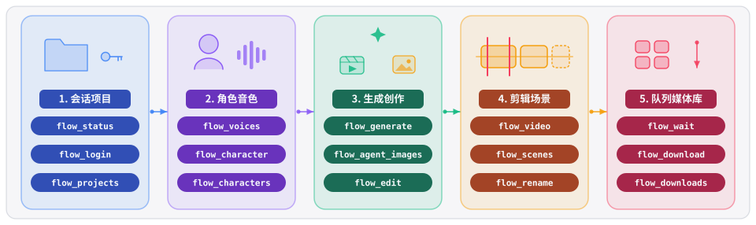
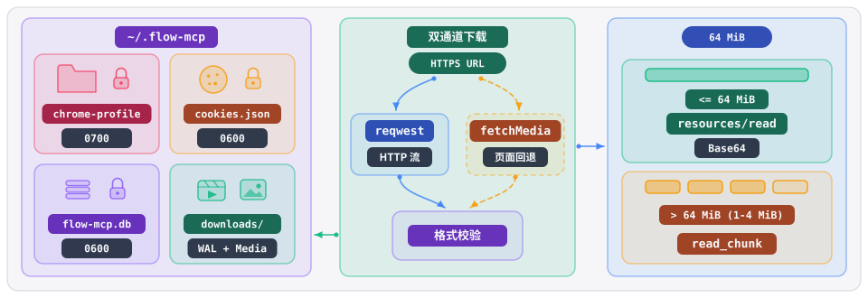

# 工作流指南

按以下步骤使用 `flow-mcp` 执行视频、图像、角色、编辑、场景、媒体库与无头 Cookie 任务。



## 1. Veo 视频生成（文本、关键帧与素材）

使用 `flow_generate` 提交文生视频任务：

```json
{
  "prompt": "Low tracking shot of a red tram gliding across wet cobblestones at dusk",
  "mode": "video",
  "model": "veo-3.1-fast",
  "aspect": "16:9",
  "duration": "8s",
  "resolution": "1080p",
  "count": 2,
  "download": true
}
```

配合 `video_type`（`"frames"` 或 `"ingredients"`）使用关键帧（`frames`）或项目素材（`asset_ids`）：

```json
{
  "prompt": "Slow push-in as neon reflections ripple across the wet street",
  "mode": "video",
  "video_type": "frames",
  "frames": ["/abs/path/start-frame.png"],
  "asset_ids": ["existing_asset_id"],
  "aspect": "16:9",
  "count": 1
}
```

等待任务完成：

```json
{
  "id": "<job_id>",
  "timeout": 600
}
```

每次 `flow_wait` 调用最多阻塞 `45` 秒，任务仍在执行时返回 `{"pending": true, ...}`。请再次调用 `flow_wait`，直到所有目标任务到达 `"done"` 状态。

## 2. Imagen 与 Agent 模式批量生图

标准生图（`mode="image"` 默认模型为 `nano-banana-2`）：

```json
{
  "prompt": "Architectural cutaway of a serene timber library in soft morning light",
  "mode": "image",
  "model": "nano-banana-2",
  "aspect": "1:1",
  "count": 4
}
```

如需运行 Flow Agent 模式批量出图，请调用 `flow_agent_images`。它使用 `480` 秒等待窗口，当错误包含 `"agent finished without creating"` 时会自动重试一次：

```json
{
  "prompt": "Create four consistent storyboard frames of a paper lantern festival by a canal",
  "model": "nano-banana-2",
  "aspect": "16:9",
  "count": 4
}
```

## 3. 跨镜头角色一致性

`flow-mcp` 提供两种在多个镜头间保持角色一致的方法：

1. **Flow 角色实体（`flow_voices`、`flow_character`、`flow_character_edit`、`flow_characters`）**：
   - 调用 `flow_voices` 列出可用音色（例如 `"Kore"` 或 `"Charon"`）。
   - 调用 `flow_character` 传入名称、描述、可选简介、音色、本地 `refs` 路径或 `asset_ids`：

```json
{
  "name": "Captain Lin",
  "description": "Weather-worn navigator in a dark navy coat with a brass compass",
  "bio": "Calm veteran orbital tug pilot",
  "voice": "Charon",
  "refs": ["/abs/path/lin-portrait.png"]
}
```

   - 在后续 `flow_generate` 调用中使用 `"characters": ["Captain Lin"]` 挂载已保存的角色。
   - 调用 `flow_character_edit` 更新角色，或调用 `flow_characters` 列出合并后的 Flow 与 SQLite 记录。

2. **轻量提示词外观（`character_role` 与 `character_look`）**：
   - 在 `flow_generate` 中传入一次 `"character_role": "courier"` 与 `"character_look": "yellow rain parka, scuffed boots"`。
   - `flow-mcp` 会将该配对保存在 SQLite（`character_looks`）中。后续你在 `flow_generate` 中传入 `"character_role": "courier"` 时，`flow-mcp` 会追加 `", character courier: yellow rain parka, scuffed boots"`。

## 4. 资产编辑、裁剪、视频续写与场景

- **编辑既有图像或视频（`flow_edit`）**：按 ID、名称或提示词子串匹配资产并提交编辑任务：

```json
{
  "match": "lantern festival",
  "prompt": "Replace dusk sky with deep starlight and warm reflections on the water"
}
```

- **在不修改源文件的情况下裁剪视频（`flow_video` 的 `action="trim"`）**：立即应用 `start_seconds` 与 `end_seconds`，无需入队任务。传入 `null` 可清除边界：

```json
{
  "action": "trim",
  "match": "red tram",
  "start_seconds": 1.2,
  "end_seconds": 6.5
}
```

- **续写视频（`flow_video` 的 `action="extend"`）**：入队一条视频续写任务（可选放入现有 `scene_id`）并接收 `JobView`：

```json
{
  "action": "extend",
  "match": "red tram",
  "prompt": "The tram turns past a clocktower into a busy square"
}
```

- **编排场景时间线（`flow_scenes`）**：列出场景、使用可选 `asset_ids` 创建场景、通过 `add_clips` 在 `position` 位置插入片段、重命名场景或将场景移入回收站：

```json
{
  "action": "add_clips",
  "id": "<scene_id>",
  "asset_ids": ["clip_asset_1", "clip_asset_2"],
  "position": 0
}
```

## 5. 项目媒体库、集合与大文件下载



- **筛选与整理项目卡片**：
  - 使用 `flow_assets` 搜索（`query`、`kind`、`collection`：集合 ID、名称子串、`"all"`、`"none"` 或 `"uncollected"`，以及 `limit`）。
  - 使用 `flow_rename` 批量重命名项目：`{"items": [{"id": "asset_1", "name": "Shot 01 - Tram"}]}`。
  - 使用 `flow_collections` 管理集合（`action`：`"list"`、`"create"`、`"rename"`、`"add"`、`"remove"`、`"delete"`）。
- **通过 MCP 下载并读取文件**：
  - 使用 `flow_download` 按需下载项目文件（`{"match": "Shot 01"}`）。
  - 使用 `flow_downloads` 管理 `<home>/flow-mcp.db` 中的记录（`"list"`、`"get"`、`"delete"`、`"prune"` 或带 `older_than_days` 的 `"clear"`）。
  - MCP `resources/read` 拒绝大于 `64 MiB` 的文件。请使用 `flow_downloads`（`action="read_chunk"`）按 Base64 分片读取（`1` 字节至 `4 MiB`，默认 `1 MiB`）：

```json
{
  "action": "read_chunk",
  "id": 1,
  "offset": 0,
  "length": 1048576
}
```

## 6. 无头服务器 Cookie 同步与恢复

在没有显示器的 Linux 服务器上运行 `flow-mcp` 时：

1. 在装有 Chrome 的电脑上运行一次 `flow_login`（`action="login"`）完成登录。
2. 将 `<home>/cookies.json`（`0600`）复制到服务器，或在无头模式下直接导入 Cookie：

```json
{
  "action": "sync_cookies",
  "cookies": [
    {
      "name": "__Secure-1PSID",
      "value": "...",
      "domain": ".google.com",
      "path": "/"
    }
  ]
}
```

3. 使用 `action="sync_cookies"` 时省略 `"cookies"`，即可将服务器本地的 `<home>/cookies.json` 重新加载到无头 Chrome。
4. 调用 `action="save_cookies"` 将 Chrome Cookie 保存到 `cookies.json`，或调用 `action="logout"` 删除 `<home>/chrome-profile` 与 `cookies.json`。
